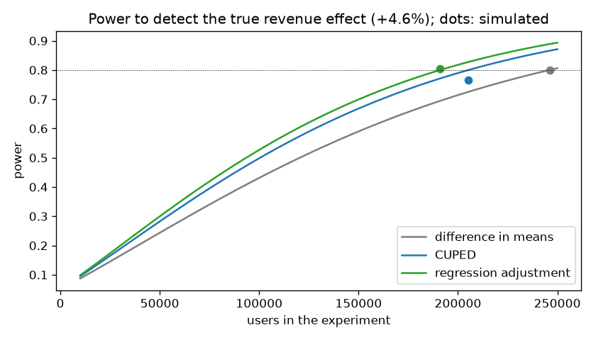
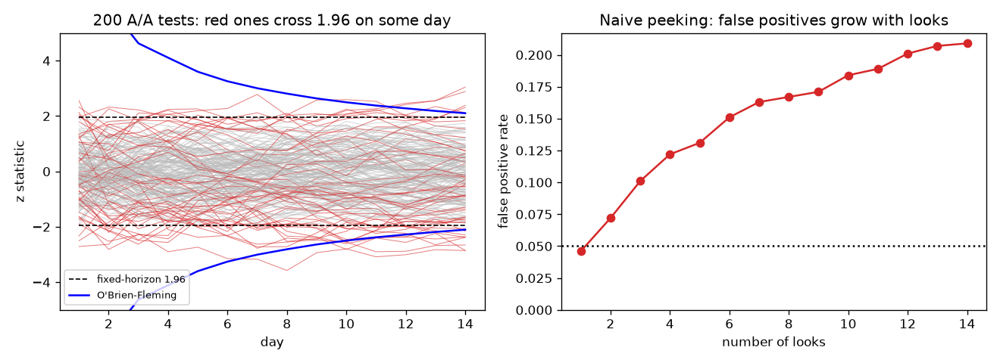
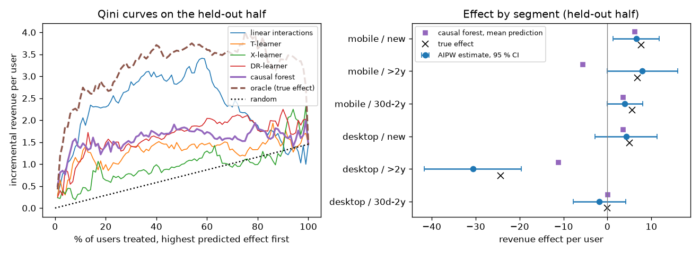

# A/B testing and experimentation

Plan, monitor and read out an online A/B test, and find which users the change helps or
harms. The project covers power analysis, variance reduction (CUPED, regression adjustment),
delta-method ratio metrics, a sample ratio mismatch check, sequential testing (group
sequential and mSPRT) and uplift modelling with EconML. A readout command turns an
experiment's data into a decision report. Everything runs on simulated data with a known
ground truth.

## Task

An e-commerce app tests a new checkout flow on 200,000 users over 14 days. Questions:

- how many users the test needs, and how much variance reduction saves;
- which estimator to trust: bias, interval coverage and power of each;
- how to monitor the test daily without inflating false positives;
- whether the average effect hides users who are harmed, and who should get the new flow;
- a repeatable readout: sample ratio check, effects with intervals, guardrails, segments, decision.

The repository uses **simulated data** ([data/experiment.csv.gz](data/experiment.csv.gz))
generated by [src/simulate.py](src/simulate.py). Each user's true effect is in the data and
the population values are in [data/truth.json](data/truth.json), so every estimate can be
checked against the truth.

## Data

One row per user:

| Column | Meaning |
|---|---|
| `group` | `treatment` or `control`, randomised 50/50 |
| `day` | day of first exposure, 1–14 |
| `device`, `country`, `tenure_days`, `tenure_group`, `new_user` | user attributes |
| `pre_revenue`, `pre_sessions` | the 8 weeks before the experiment, used as covariates |
| `sessions`, `orders`, `converted`, `revenue` | the experiment period |
| `true_revenue_effect`, `true_conversion_effect` | the user's true effect (simulation only) |

Simulated mechanism: each user has a latent shopping intensity (Gamma) and a typical order
value (log-normal, by country). Orders in a period are Poisson, and revenue is orders × order
value × noise. The treatment multiplies the order rate by exp(δ), with δ depending on the user:

| Segment | Share | δ | True effect, revenue per user |
|---|---|---|---|
| mobile, new users | 15 % | +0.22 | +7.8 |
| mobile, tenure 30 days – 2 years | 34 % | +0.10 | +5.6 |
| mobile, tenure > 2 years | 11 % | +0.10 | +6.7 |
| desktop, new users | 10 % | +0.12 | +5.2 |
| desktop, tenure 30 days – 2 years | 23 % | 0 | 0 |
| desktop, tenure > 2 years | 7 % | −0.35 | **−24.0** |

On average the new checkout adds **+2.55 revenue per user (+4.6 %)** and +0.39 percentage
points of conversion (+4.2 %). But it cuts orders by 30 % for long-standing desktop users, as
if, say, their saved payment methods did not carry over. Revenue is heavy-tailed (standard
deviation 4 times the mean), as it usually is.

## Solution

1. **Power analysis** ([src/power.py](src/power.py)): variance, and the correlation with the
   pre-period, are estimated on historical users. Sample size for a range of minimum
   detectable effects follows, with σ² reduced to σ²(1 − ρ²) for CUPED and σ²(1 − R²) for
   regression adjustment. The analytic sample sizes are then checked by simulating
   experiments of that size.
2. **Estimators** ([src/estimators.py](src/estimators.py)):
   - difference in means (Welch);
   - CUPED, with the pre-period revenue as covariate;
   - regression adjustment, Lin (2013): OLS with centred covariates interacted with
     treatment, HC2 errors;
   - revenue per session as a ratio metric with delta-method errors;
   - relative lift with a delta-method interval;
   - sample ratio mismatch check (chi-square).

   A Monte Carlo study runs 500 A/B and 500 A/A experiments of 200,000 users and compares
   each estimator with the truth.
3. **Sequential testing** ([src/sequential.py](src/sequential.py)): the test is looked at
   daily. Compared:
   - a fixed-horizon test;
   - naive peeking (stop at the first p < 0.05);
   - group sequential with O'Brien–Fleming-type alpha spending (Lan–DeMets; boundaries
     for 14 looks from simulated Brownian motion; checked against published values for 5 looks);
   - mSPRT, with a normal mixture prior and always-valid p-values.

   Each runs on 1,000 A/A and 1,000 A/B experiments, with and without CUPED.
4. **Uplift** ([src/uplift.py](src/uplift.py)): per-user effect models are trained on one
   half of the experiment and evaluated on the other:
   - OLS with treatment interactions;
   - T-learner (gradient boosting);
   - X-learner, DR-learner and causal forest (EconML).

   Evaluation compares predictions with the true effects and uses Qini curves. It also
   values the targeting policy "treat if predicted effect > 0", with both its true value
   and its inverse-propensity estimate from observed outcomes. In addition, segment effects
   are estimated from doubly robust (AIPW) scores, and a policy excludes segments whose
   effect is significantly negative (Bonferroni-corrected).
5. **Readout** ([src/readout.py](src/readout.py)): one command from a user-level CSV to a
   Markdown report. Its seven parts:
   - sample ratio check, located by segment when it fails;
   - metrics with CUPED;
   - ratio metrics;
   - guardrails;
   - an always-valid p-value over the daily looks;
   - segment effects with Holm correction and a heterogeneity test;
   - a decision with reasons.

## Results

**Power analysis** — users needed for 80 % power at α = 0.05 (revenue per user):

| Relative MDE | Difference in means | CUPED | Regression adjustment |
|---|---|---|---|
| 3 % | 591,000 | 493,000 | 459,000 |
| 5 % | 213,000 | 178,000 | 165,000 |
| 7 % | 109,000 | 91,000 | 84,000 |
| 10 % | 53,000 | 44,000 | 41,000 |

The pre-period correlation is ρ = 0.41, so CUPED needs 17 % fewer users. Regression
adjustment, with R² = 0.22, needs 22 % fewer. With 200,000 users the detectable effect is
5.2 % / 4.7 % / 4.5 %. The planned sample sizes hold up in simulation: experiments sized for
80 % power reached 80.0 % (difference in means), 76.7 % (CUPED) and 80.3 % (regression), each
over 300 simulations (± 2.3 points).



**Estimators**: 500 experiments of 200,000 users, true effect +2.55 per user:

| Method | Bias | SD of estimates | Mean SE | 95 % coverage | Power | Variance vs. difference in means |
|---|---|---|---|---|---|---|
| Difference in means | +0.005 | 1.01 | 1.03 | 96.4 % | 70.4 % | 1.00 |
| CUPED | +0.021 | 0.91 | 0.94 | 95.6 % | 78.4 % | 0.82 |
| Regression adjustment | +0.026 | 0.90 | 0.91 | 95.0 % | **80.0 %** | **0.80** |
| Revenue per session (delta method) | +0.003 | 0.14 | 0.15 | 96.0 % | 77.8 % | – |

In 500 A/A experiments the false positive rates are 4.4 %, 3.6 %, 3.2 % and 3.8 %. All four
estimators are unbiased with correct standard errors. Variance reduction gives the same
answer as 25 % more traffic.

**Sequential testing**: 1,000 A/A and 1,000 A/B experiments, looked at every day for 14 days:

| Method | False positive rate | Power | Mean stopping day when significant | Expected days run |
|---|---|---|---|---|
| Fixed horizon, day 14 | 4.6 % | 68.7 % | 14 | 14 |
| Naive peeking, daily | **20.9 %** | 79.5 % | 6.0 | 7.6 |
| O'Brien–Fleming, daily | 5.2 % | 66.8 % | 10.2 | 11.4 |
| mSPRT, daily | 0.6 % | 34.1 % | 9.2 | 12.4 |
| Fixed horizon + CUPED | 5.2 % | 75.0 % | 14 | 14 |
| O'Brien–Fleming + CUPED | 4.6 % | **73.0 %** | 9.9 | **11.0** |

Checking a fixed-horizon test every day and stopping at the first significant result
quadruples the false positive rate to 21 %. O'Brien–Fleming boundaries keep it at 5 %, are very
strict early (z > 4.6 on day 3) and close to the fixed test at the end (2.10 on day 14). They
lose about 2 points of power and, when there is an effect, finish 2.6 days earlier on average. With
CUPED added, the sequential test is more powerful than the plain fixed-horizon test. mSPRT is
valid under any monitoring schedule but conservative here: it pays for that flexibility with
power.



**Uplift**: models trained on 100,000 users, evaluated on the other 100,000:

| Model | RMSE vs. true effect | Correlation with true effect | Users treated | True gain vs. treat all | Share of oracle gain | IPW estimate of gain (95 % CI) |
|---|---|---|---|---|---|---|
| Linear interactions | 19.9 | 0.35 | 55 % | +0.59 | 33 % | +1.27 (−0.81 to 3.35) |
| T-learner | 37.9 | 0.34 | 68 % | +0.12 | 7 % | +0.27 (−1.73 to 2.27) |
| X-learner | 25.3 | 0.45 | 70 % | +0.55 | 30 % | −0.44 (−2.51 to 1.63) |
| DR-learner | 29.0 | 0.51 | 61 % | +0.55 | 30 % | +0.55 (−1.50 to 2.61) |
| Causal forest | **17.3** | 0.48 | 66 % | +0.69 | 38 % | +0.16 (−1.82 to 2.13) |
| **Segments (AIPW): exclude desktop / > 2 years** | – | – | 93 % | **+1.81** | **100 %** | **+1.91 (0.93 to 2.89)** |

Treating only the users with a positive true effect would add 1.81 revenue per user
compared with treating everyone; this is the oracle gain. The per-user models rank users
better than random, but revenue is too noisy to estimate effects user by user at this sample
size. Their targeting policies withhold the new flow from many users who gain from it,
capture 7–38 % of the oracle gain, and the gain cannot be told apart from zero on observed data.

The segment analysis works better. Its doubly robust estimates cover the truth in all six
segments, and it finds the harmed group (−30.6, 95 % CI −41.6 to −19.7; true −24.3).
Excluding that group captures the full oracle gain, and the gain is significant on observed
outcomes alone. The simulated effect is constant within these segments, which favours the
segment approach. On real data the segments would be fixed in advance as hypotheses, and a
causal forest is the tool for finding ones nobody thought of. Here the causal forest ranks
`tenure_years` third in importance and points to the right group, but shrinks its effect
(−11 vs. −24).



**Readout** of the experiment: [results/readout.md](results/readout.md).

- Sample ratio: 99,985 vs. 100,015, p = 0.95.
- Revenue: **+1.0 % (95 % CI −2.3 % to +4.3 %), p = 0.55**, after CUPED cut the variance by 17 %.
- Conversion: +2.8 % (+0.2 % to +5.4 %).
- Sessions guardrail: unchanged.
- Always-valid p after 14 days: 0.40.
- Segments differ (heterogeneity p < 0.001). Desktop users with more than 2 years' tenure
  lose **−33.2 (−41.3 to −25.1)**; mobile new and mobile 30 days – 2 years gain +8.7 and
  +5.9 (Holm p < 0.001).
- **Decision: do not ship as is.** Fix the flow for the harmed group and re-test, or roll
  out only where it helps, confirmed by a follow-up test.

This dataset is an unlucky draw. The overall revenue estimate is 2 standard errors below
the true +2.52 of these users, and the interval just misses it, as about 1 in 20 intervals
will. The Monte Carlo study above shows the estimators are unbiased with correct coverage.
Segment intervals also cover the truth in 94 % of 180 simulated cases. A readout reports
what the data show. Under the true effects the advice would be the same in substance: the new flow pays
off overall, but not before the harmed group is fixed or excluded.

**Sample ratio mismatch**: [results/readout_srm.md](results/readout_srm.md). The same
experiment with a logging bug: 5 % of mobile treatment users who don't buy are lost before
their exposure is logged, 2.7 % of the treatment arm.

- Split: 97,252 vs. 100,015, p < 0.001.
- By segment, the mismatch is in mobile only (48.8 % treatment share; desktop 50.1 %).
- The bug makes revenue look **significant: +3.3 %, p = 0.047**, and inflates conversion to
  +5.4 %.
- The readout withholds a decision until the cause is found.

With 40,000 users the same bug gives p = 0.07 and goes unnoticed. A small mismatch needs a
large sample to detect, which is why the check uses a strict threshold (p < 0.001) on every
experiment.

## Project structure

```
ab-testing-experimentation/
├── README.md
├── requirements.txt
├── data/
│   ├── experiment.csv.gz   # simulated experiment, 200,000 users
│   └── truth.json          # true parameters, population and per-segment effects
├── results/                # tables, readouts and figures used in this README
├── src/
│   ├── simulate.py         # experiment simulator with known per-user effects; --srm-bug
│   ├── estimators.py       # difference in means, CUPED, Lin regression, delta method, SRM; Monte Carlo study
│   ├── power.py            # sample size, MDE, simulated power check
│   ├── sequential.py       # peeking, O'Brien-Fleming alpha spending, mSPRT
│   ├── uplift.py           # meta-learners and causal forest (EconML), Qini, AIPW segments, policies
│   └── readout.py          # command line: experiment CSV -> decision report
└── tests/                  # pytest: simulator truth, estimator formulas, boundaries, uplift, readout
```

## Usage

```sh
uv venv && source .venv/bin/activate     # or: python -m venv .venv
uv pip install -r requirements.txt       # or: pip install -r requirements.txt
pytest tests

cd src
python simulate.py --output ../data/experiment.csv.gz --truth ../data/truth.json   # optional, data is included
python readout.py --input ../data/experiment.csv.gz --output ../results/readout.md
python power.py        # ~8 min: simulated power check
python estimators.py   # ~9 min: 1,000 experiments of 200,000 users
python sequential.py   # ~8 min: 2,000 experiments with daily looks
python uplift.py       # ~1.5 min

python simulate.py --output ../data/experiment_srm.csv.gz --srm-bug
python readout.py --input ../data/experiment_srm.csv.gz --output ../results/readout_srm.md
```

The readout works on any user-level CSV; the column names are arguments:

```sh
python readout.py --input my_test.csv --output report.md \
    --metrics revenue,converted --covariates revenue=pre_revenue,converted=pre_revenue \
    --ratios revenue/sessions --guardrails sessions --segments device,tenure_group --day day
```

Leave out `--day` if there is no exposure date, and `--covariates` if there is no pre-period
data. The first metric is the primary one and drives the decision.
