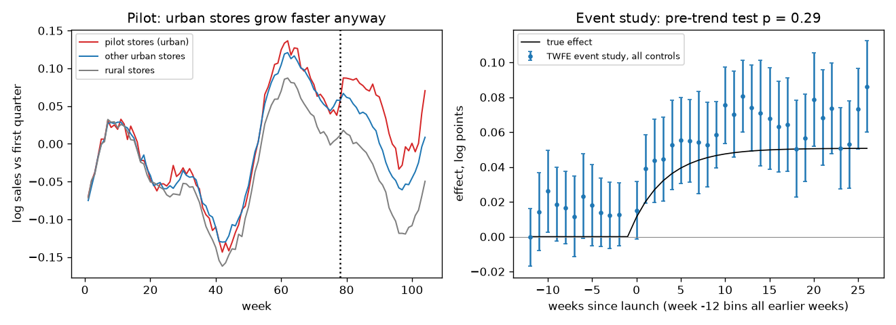
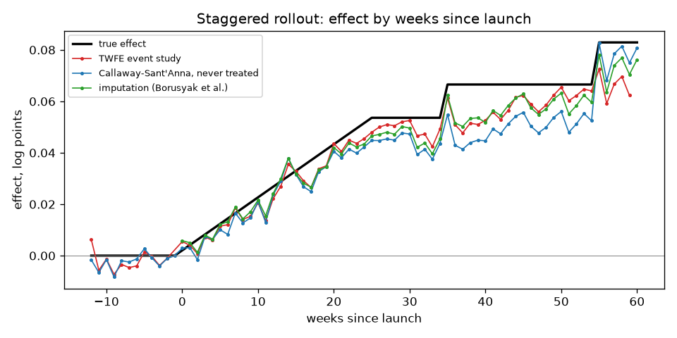
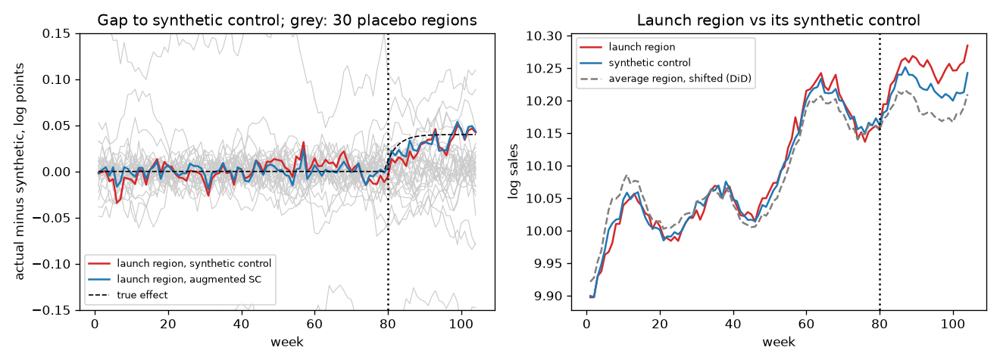

# Difference-in-differences and synthetic control

Measure the sales effect of a launch that was not randomised, in three situations:

- a pilot in hand-picked stores;
- a rollout in waves;
- a launch in a single region.

The project compares classic and modern difference-in-differences estimators with synthetic
control methods, on simulated store panels with a known true effect. It shows when each one
is biased. An impact readout turns launch data into a report with a recommended estimate.

## Task

A retail chain launches a new in-store service. Stores and regions were not randomised, so
the effect has to be inferred from weekly sales before and after the launch. Questions:

- does a plain before/after comparison with other stores (difference-in-differences) give
  the right answer, and can a pre-trend test tell when it doesn't;
- how to estimate the effect when stores launch at different times and the effect grows
  over time;
- how to measure a launch in one region, with 30 other regions as possible controls;
- which estimate to report, with which uncertainty.

The data are **simulated** by [src/simulate.py](src/simulate.py); every row carries its
true effect (`true_effect`), and [data/truth.json](data/truth.json) holds the true average
effects, so every estimate can be checked.

## Data

Three panels of 104 weeks:

| File | Units | Launch | Why it is hard |
|---|---|---|---|
| [pilot.csv.gz](data/pilot.csv.gz) | 200 stores | 25 urban stores in week 78 | urban stores grow ~3 % a year faster anyway, so parallel trends hold only within urban stores |
| [staggered.csv.gz](data/staggered.csv.gz) | 200 stores | waves of 40 stores in weeks 30, 50 and 70; 80 stores never | the effect builds up over half a year, and is larger for early waves (+8 %, +5 %, +3 %) |
| [market.csv.gz](data/market.csv.gz) | 31 regions | one region in week 80 | regions follow three latent factors; the launch region is more exposed to the growth factor than the average region |

Columns:

- `store` or `region`, `week`;
- store attributes `region`, `urban` and `size_index`;
- `launch_week`, empty for units that never launched;
- `sales` in thousand SEK;
- `true_effect`, in log points.

Store sales are built from these parts:
- store size;
- a chain-wide trend (a random walk);
- seasonality;
- region shocks (random walks);
- the urban growth trend;
- AR(1) noise.

After launch, log sales rise by the true effect. It ramps up over about a month in the pilot
and the market launch, and over half a year in the rollout. Effects are analysed in log
points (0.044 ≈ +4.5 %).

## Solution

1. **Difference-in-differences** ([src/did.py](src/did.py)):
   - **2×2 DiD**: launched vs. other units, mean after minus mean before, with standard
     errors from unit-level changes. Also a matched version with urban controls only.
   - **Doubly robust DiD** (Sant'Anna & Zhao 2020): parallel trends only among units with the
     same covariates (urban, size, region). It combines a propensity score with an outcome
     regression of the change, and is consistent if either model is right.
   - **TWFE**: regression on unit and week fixed effects plus the launch dummy, errors
     clustered by store. Also an event study with leads and lags of the launch.
   - **Pre-trend test**: Hotelling T² comparing the pre-launch changes of launched and
     control units. The usual cluster-robust Wald test on event-study leads rejected 14–17 %
     of the time instead of 5 % with 20–25 treated stores, so it was replaced. The Hotelling
     test holds its size (4 %).
   - **Staggered rollouts**:
     - Callaway & Sant'Anna (2021): an effect for each launch wave and week, against
       never-treated or not-yet-treated stores, then averaged.
     - The imputation estimator (Borusyak, Jaravel & Spiess 2024): fits store and week
       effects on not-yet-launched store-weeks only, and imputes the no-launch sales of
       launched ones.
     - The weights TWFE puts on each launched store-week (de Chaisemartin & D'Haultfœuille);
       negative weights mean already-launched stores are used as controls.
2. **Synthetic control** ([src/synth.py](src/synth.py)):
   - **Synthetic control** (Abadie et al.): non-negative weights on control units, summing
     to one, that reproduce the pre-launch path.
   - **Augmented synthetic control** (Ben-Michael, Feller & Rothstein 2021): a ridge
     correction for the pre-launch fit the weights cannot achieve.
   - **Synthetic DiD** (Arkhangelsky et al. 2021): regularised unit weights plus time
     weights, then a weighted DiD.

   Inference uses placebos: every control region, or random groups of control stores, is
   analysed as if it had launched. Weights are found by non-negative least squares with a
   sum-to-one constraint.
3. **Monte Carlo study** ([src/study.py](src/study.py)): 200 new panels per scenario.
   Every method is compared with that panel's true effect: bias, RMSE, 95 % interval coverage
   and the share of significant results. Panels run in parallel processes.
4. **Impact readout** ([src/impact.py](src/impact.py)): from a launch panel (CSV) to a
   Markdown report with:
   - the design: one date, one unit or staggered;
   - a pre-trend test;
   - the estimates that suit the design, side by side;
   - a recommended estimate, with the reason;
   - an event-study figure.

## Results

All Monte Carlo results come from 200 simulated panels per scenario.

**Pilot in urban stores**: true effect +4.4 % on average:

| Method | Bias | RMSE | Mean SE | 95 % coverage |
|---|---|---|---|---|
| DiD, all controls | **+0.022** | 0.023 | 0.008 | **23 %** |
| DiD, urban controls only | +0.000 | 0.008 | 0.009 | 96.5 % |
| Doubly robust DiD | +0.001 | **0.006** | 0.006 | 95.5 % |
| Synthetic control | +0.010 | 0.012 | 0.007 | 65 % |
| Augmented synthetic control | +0.009 | 0.012 | 0.007 | 65.5 % |
| Synthetic DiD | +0.011 | 0.013 | 0.006 | 48 % |
| Synthetic control, urban donors | +0.000 | 0.007 | 0.008 | 96.5 % |
| Augmented synthetic control, urban donors | +0.000 | 0.007 | 0.009 | 97.5 % |
| Synthetic DiD, urban donors | +0.001 | 0.006 | 0.008 | 97.5 % |

Plain DiD overstates the effect by half (+6.7 % instead of +4.4 %), and its intervals miss
the truth 77 % of the time. **The pre-trend test catches this in only 32 % of pilots.** The
urban stores diverge slowly, about 0.04 % a week, which is hard to see in 12 weeks of noisy
sales. A passed pre-trend test is not evidence of parallel trends.

What works is comparing like with like: doubly robust DiD with the store attributes, or DiD
against urban stores only. Synthetic control methods help less than one might expect. With
all 175 stores as donors, they partly match the urban growth with region shocks that happened
to trend upward before launch, and those don't continue. Restricted to urban donors, all three
are unbiased.



**Staggered rollout**: true effect +4.8 % on average:

| Method | Bias | RMSE | Mean SE | 95 % coverage |
|---|---|---|---|---|
| TWFE | **−0.015** | 0.015 | 0.004 | **4.5 %** |
| Callaway–Sant'Anna, never treated | −0.000 | 0.005 | 0.006 | 96 % |
| Callaway–Sant'Anna, not yet treated | −0.000 | 0.005 | 0.006 | 95.5 % |
| Imputation estimator | −0.000 | **0.004** | 0.005 | 97 % |

TWFE reports +3.3 % for a +4.8 % effect, and its interval almost never covers the truth.
The bias is fully explained by its weights. 21 % of launched store-weeks get a negative
weight: TWFE uses stores that launched earlier, whose effect is still growing, as controls
for later ones. Weighted by the TWFE weights, the true effects give 0.0327 against a true
average of 0.0471, which matches the bias observed. Callaway–Sant'Anna and the imputation
estimator are unbiased; the imputation estimator is the most precise.

A fully dynamic TWFE event study, with never-treated stores in the data, tracks the effect
path much better than the single TWFE coefficient (figure). The bias sits in the one-number
summary most often reported.



**Single-region launch**: true effect +3.7 %:

| Method | Bias | RMSE | Mean placebo SE | 95 % coverage | Significant (placebo p < 0.05) |
|---|---|---|---|---|---|
| DiD | **+0.076** | 0.081 | 0.067 | 98.5 % | 29 % |
| Synthetic control | +0.018 | 0.052 | 0.052 | 94.5 % | 4 % |
| Augmented synthetic control | **+0.002** | **0.009** | 0.009 | 93.5 % | **96 %** |
| Synthetic DiD | +0.007 | 0.015 | 0.015 | 95 % | 67.5 % |

DiD triples the effect: the launch region grows faster than the average region. Its placebo
spread is so wide that the result is rarely significant, and the interval is uninformative.

Plain synthetic control often cannot reproduce the launch region's level and path from the
others, so it fits poorly in some panels. The pre-launch fit stays visible in the gap plot,
which is why the method is always shown with it.

Augmented synthetic control corrects the remaining imbalance: it is unbiased, 6 times more
precise than synthetic control, and detects the effect in 96 % of panels. The pre-trend test
has no power here (5.5 % rejections). With such different regions, the launch region's extra
growth looks normal among them.



**Impact readouts** of the included datasets:

| Dataset | True effect | Readout recommends | Estimate (95 % CI) | Plain DiD / TWFE |
|---|---|---|---|---|
| Pilot ([report](results/impact_pilot.md)) | +4.5 % | doubly robust DiD | **+4.4 %** (+3.1 % to +5.7 %) | DiD +6.0 %, flagged as biased |
| Staggered ([report](results/impact_staggered.md)) | +4.9 % | imputation estimator | **+4.3 %** (+3.3 % to +5.3 %) | TWFE +2.9 %, flagged |
| Market ([report](results/impact_market.md)) | +3.7 % | augmented synthetic control | **+3.1 %** (+1.4 % to +4.9 %) | DiD +5.9 % (−6.6 % to +20.1 %) |

In the pilot, the pre-trend test passes (p = 0.29) while plain DiD is biased. The readout
therefore doesn't rely on the test. With store attributes given, it reports doubly robust
DiD, and it flags plain DiD because the two differ by more than 2 standard errors. All three
recommended intervals contain the true effect.

## Project structure

```
did-synthetic-control/
├── README.md
├── requirements.txt
├── data/
│   ├── pilot.csv.gz, staggered.csv.gz, market.csv.gz   # simulated panels with true effects
│   └── truth.json                                     # true average effects per scenario
├── results/        # Monte Carlo tables, estimates on the datasets, readouts and figures
├── src/
│   ├── simulate.py   # panel simulators with known effects
│   ├── panel.py      # long table -> unit x week matrix
│   ├── did.py        # 2x2, doubly robust, TWFE, event study, pre-trend test, Callaway-Sant'Anna, imputation
│   ├── synth.py      # synthetic control, augmented SC, synthetic DiD, placebo inference
│   ├── study.py      # Monte Carlo comparison and figures (parallel)
│   └── impact.py     # command line: launch panel -> impact report
└── tests/            # pytest: estimator formulas vs statsmodels, known-answer cases, test size, readout
```

## Usage

```sh
uv venv && source .venv/bin/activate     # or: python -m venv .venv
uv pip install -r requirements.txt       # or: pip install -r requirements.txt
pytest tests                             # ~10 s

cd src
python simulate.py --all --truth ../data/truth.json      # optional, data is included
python study.py --reps 200                               # ~5 min on 8 cores
python impact.py --input ../data/pilot.csv.gz --unit store \
    --covariates urban,size_index,region --match urban --output ../results/impact_pilot.md
python impact.py --input ../data/staggered.csv.gz --unit store --output ../results/impact_staggered.md
python impact.py --input ../data/market.csv.gz --unit region --output ../results/impact_market.md
```

The readout works on any balanced panel. The column names are arguments (`--unit`, `--time`,
`--outcome`, `--launch`), and the outcome is analysed in logs unless `--no-log` is given.
`--covariates` are unit attributes for doubly robust DiD. `--match` limits the
synthetic-control donors to units that share those attributes with the launched ones.
