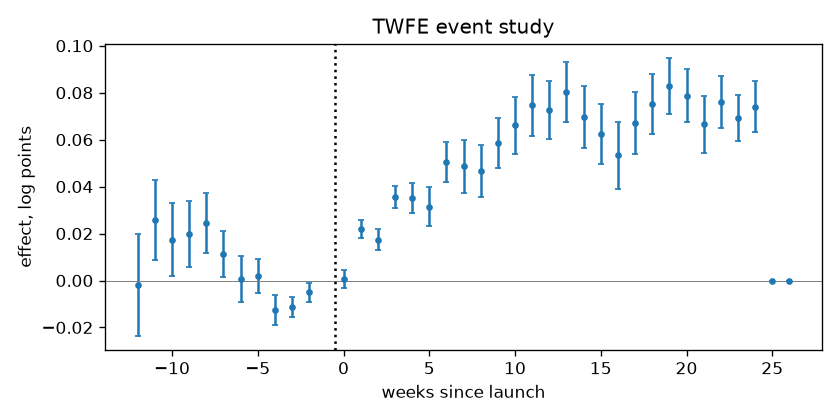

# Launch impact readout

## 1. Design

31 regions × 104 weeks; outcome: log sales. 1 launched, 30 never launched. Launch week: 80.

## 2. Pre-trends

Joint test that the effects before launch are zero (Hotelling T² on changes in the 12 weeks before launch and from earlier weeks, launched vs control units): p = 0.805 — no evidence against parallel trends. A passed test does not prove them: it has little power against slow divergence.

## 3. Estimates

Average effect on launched units after launch.

| method | effect | 95 % CI | log points (SE) | p | note |
|---|---|---|---|---|---|
| DiD | +5.9% | -6.6% to +20.1% | 0.0574 (0.0643) | 0.484 (placebo) |  |
| synthetic control | +2.8% | -5.1% to +11.3% | 0.0273 (0.0406) | 0.290 (placebo) |  |
| augmented synthetic control | +3.1% | +1.4% to +4.9% | 0.0308 (0.0087) | 0.032 (placebo) |  |
| synthetic DiD | +4.6% | +1.4% to +7.9% | 0.0452 (0.0158) | 0.032 (placebo) |  |

Synthetic control pre-launch fit: RMSPE 0.0110 log points.

## 4. Recommendation

**augmented synthetic control: +3.1% (95 % CI +1.4% to +4.9%).** Why: one treated unit: inference comes from placebo regions. Augmented SC keeps the synthetic control idea and corrects the part of the pre-launch path it cannot match.

