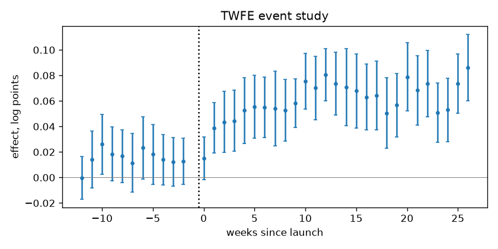

# Launch impact readout

## 1. Design

200 stores × 104 weeks; outcome: log sales. 25 launched, 175 never launched. Launch week: 78.

## 2. Pre-trends

Joint test that the effects before launch are zero (Hotelling T² on changes in the 12 weeks before launch and from earlier weeks, launched vs control units): p = 0.291 — no evidence against parallel trends. A passed test does not prove them: it has little power against slow divergence.

## 3. Estimates

Average effect on launched units after launch.

| method | effect | 95 % CI | log points (SE) | p | note |
|---|---|---|---|---|---|
| DiD | +6.0% | +4.2% to +7.9% | 0.0584 (0.0090) | < 0.001 |  |
| doubly robust DiD | +4.4% | +3.1% to +5.7% | 0.0427 (0.0062) | < 0.001 |  |
| synthetic control, donors matched on urban | +4.9% | +3.2% to +6.7% | 0.0483 (0.0084) | 0.010 (placebo) |  |
| augmented synthetic control, donors matched on urban | +5.0% | +3.2% to +6.8% | 0.0488 (0.0088) | 0.010 (placebo) |  |
| synthetic DiD, donors matched on urban | +5.1% | +3.3% to +6.9% | 0.0496 (0.0089) | 0.010 (placebo) |  |

Plain DiD differs from doubly robust DiD by +0.0157 log points (more than 2 SE): launched units trend differently from the average control, so plain DiD is biased.

## 4. Recommendation

**doubly robust DiD: +4.4% (95 % CI +3.1% to +5.7%).** Why: doubly robust DiD needs parallel trends only among similar units (same urban, size_index, region), a weaker assumption than plain DiD, which compares with all controls.

