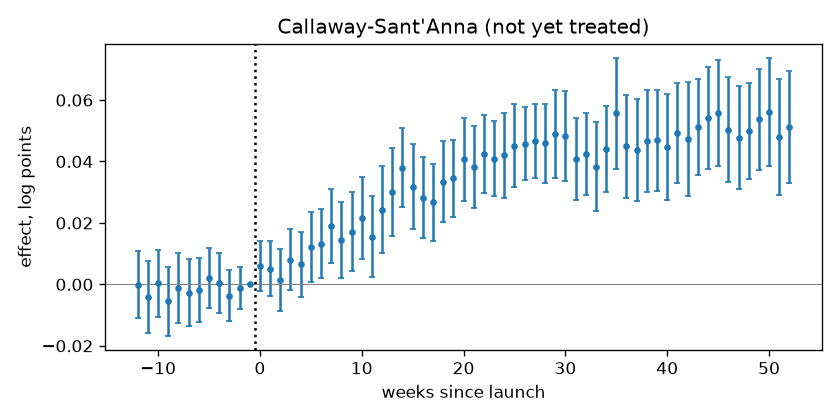

# Launch impact readout

## 1. Design

200 stores × 104 weeks; outcome: log sales. 120 launched, 80 never launched. Launch weeks: 30, 50, 70 (staggered).

## 2. Pre-trends

Joint test that the effects before launch are zero (Callaway-Sant'Anna (not yet treated) effects in the 12 weeks before launch): p = 0.718 — no evidence against parallel trends. A passed test does not prove them: it has little power against slow divergence.

## 3. Estimates

Average effect on launched units after launch.

| method | effect | 95 % CI | log points (SE) | p | note |
|---|---|---|---|---|---|
| TWFE | +2.9% | +2.0% to +3.7% | 0.0282 (0.0043) | < 0.001 | 21% of treated weeks get negative weight |
| Callaway-Sant'Anna, never treated | +4.0% | +2.9% to +5.2% | 0.0397 (0.0055) | < 0.001 |  |
| Callaway-Sant'Anna, not yet treated | +4.1% | +3.0% to +5.3% | 0.0406 (0.0055) | < 0.001 |  |
| imputation (Borusyak et al.) | +4.3% | +3.3% to +5.3% | 0.0421 (0.0051) | < 0.001 |  |

TWFE differs from the robust estimators by -0.0139 log points: do not use it here.

## 4. Recommendation

**imputation (Borusyak et al.): +4.3% (95 % CI +3.3% to +5.3%).** Why: launch dates differ, so TWFE compares later launchers with stores that launched earlier and are still changing; the imputation estimator only uses not-yet-launched store-weeks as controls and is the most precise of the robust estimators. Callaway-Sant'Anna is the check.

