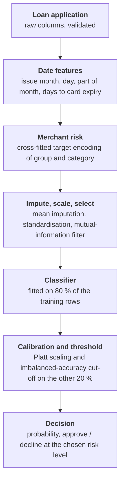

# Loan default prediction

Predict the probability that a short-term point-of-sale loan defaults, turn it into an
approve / decline decision at a risk level the user can choose, and serve it through a REST
API. Six models are compared on the same folds: logistic regression, gradient boosting
(class-balanced and unweighted), a neural network and two policy-gradient (REINFORCE)
classifiers. Each model's probabilities are calibrated. Models are selected by imbalanced
accuracy, and every standard credit-scoring metric is reported as well.

## Task

A borrower buys from a merchant and pays later. The loan is due 14 days after the
purchase, and a 7-day reminder period follows. A loan still unpaid after that goes to
collection. Each record is one loan at the moment it is issued:

- the loan amount and issue date, and the card's expiry month and year;
- the borrower's existing debt, number of active loans, and days since their first loan;
- new credit taken in the last 7 and 14 days;
- payments made on time in the last 3 and 6 months, and failed payments in the last 3 months, 6 months and 1 year;
- amounts repaid in the last 14 days, 1, 3 and 6 months, and 1 year;
- the merchant group and category.

The outstanding balance at the due date and after the reminder period are also given, but
not as predictors. Choosing the target definition is part of the task. The model has to
give reliable probabilities, and the users of the decision need to be able to choose their
own risk level. Deliverables: an API that can be hosted locally, a write-up of the target,
training and evaluation, and readable code.

No original data is included in this repository. It uses **simulated data**
generated by [src/simulate.py](src/simulate.py). The true mechanism is stored in
[data/truth.json](data/truth.json), and the true probability of every loan is written
next to the data, so models can be compared with the best possible score.

## Data

40,000 simulated loans issued over 18 months, with volume growing over time. 8.0 % of
them default. Amounts and repayments are log-normal, failed payments are zero-inflated
counts, and the repayment windows are nested (14 days ⊂ 1 month ⊂ … ⊂ 1 year). 12 % of
borrowers are new and have no history. Existing debt is missing for 5 % of loans (more
often for new borrowers) and card expiry for 2 %. There are 4 merchant groups with 3
categories each.

| Column | Meaning |
|---|---|
| `issue_date`, `amount` | issue date, loan amount |
| `card_exp_month`, `card_exp_year` | card expiry (may be missing) |
| `existing_debt` | current debt of the borrower (may be missing; negative = credit balance) |
| `active_loans`, `history_days` | active loans, days since the first loan |
| `new_credit_7d`, `new_credit_14d` | new credit taken in the last 7 / 14 days |
| `paid_on_time_3m`, `paid_on_time_6m` | payments made on time |
| `failed_payments_3m`, `_6m`, `_1y` | failed payments |
| `repaid_14d`, `_1m`, `_3m`, `_6m`, `_1y` | amounts repaid |
| `merchant_group`, `merchant_category` | merchant |
| `outstanding_due`, `outstanding_after_grace` | balance at day 14 and day 21 (outcomes, not predictors) |

Simulated mechanism: the log-odds of default rise with:

- failed payments;
- debt relative to the amount repaid in the last year;
- new credit relative to the loan amount;
- a card that expires before the due date;
- the loan amount;
- the merchant effect.

They fall with longer history. They also drift upward by 0.03 per month, so later loans
are riskier. An **unobserved reliability** term enters the log-odds as well. It shows only
indirectly, through failed payments, so no model reaches the true probabilities. Defaulted
loans keep part of the amount outstanding after the reminder period. 10 % of the loans
that are repaid are late at the due date but paid during the reminder period.

## Solution



1. **Target** ([src/schema.py](src/schema.py)): default = any balance still outstanding
   after the reminder period (day 21). A loan that is late at day 14 but paid during the
   reminder period is not a default. Both outstanding balances are excluded from the
   features. Input validation checks that the columns are present, that values are numeric
   and non-negative, that card months are valid, and that nested windows are consistent.
   It reports every problem at once.
2. **Features** ([src/features.py](src/features.py)): one scikit-learn pipeline, so every
   step is fitted inside the training fold:
   - date features. The issue year is left out because it does not carry over to future loans;
   - merchant default rates from `TargetEncoder`. It smooths small categories, uses
     cross-fitting so that a training row never sees its own target, and gives unseen
     merchants the global rate;
   - mean imputation and standardisation;
   - a mutual-information filter that drops features with MI ≤ 0.001.
3. **Models** ([src/models.py](src/models.py)):

   | Name | Model |
   |---|---|
   | `logreg` | logistic regression (baseline) |
   | `hgb_balanced` | gradient boosting (`HistGradientBoostingClassifier`, depth 3, 5 leaves, L2 0.5) with class-balanced weights |
   | `hgb` | the same, trained on the true class ratio |
   | `mlp` | feed-forward network 256-48 with batch norm and dropout, binary cross-entropy weighted by the class ratio, 30 epochs |
   | `rl_linear` | linear REINFORCE policy, 15 epochs |
   | `rl_deep` | REINFORCE policy 96-67-102, 20 epochs |

   The network architectures come from an earlier Optuna search. They are not re-tuned here.
   The REINFORCE policies sample an approve / decline action per loan. A correct decision
   earns +1 on a repaid loan and +w on a default, where w is the ratio of repaid to
   defaulted loans; a wrong one earns the same amount negative. The batch-mean reward is
   subtracted as a baseline.
4. **Calibration and threshold** (`CalibratedClassifier`): each model is fitted on 80 % of
   the training rows. On the other 20 %:
   - its scores are mapped to probabilities by Platt scaling (logistic regression on the
     logit of the score);
   - the cut-off that maximises imbalanced accuracy is chosen.

   Platt scaling keeps the ranking. Isotonic regression was also tried, but its steps tie
   scores and lose ranking quality (see the ablation).
5. **Metrics** ([src/metrics.py](src/metrics.py)): the primary metric is **imbalanced
   accuracy** (A. Shipitsyn, *Statistical Learning with Imbalanced Data*, MSc thesis,
   Linköping University, 2017, [DiVA diva2:1119403](https://www.diva-portal.org/smash/get/diva2:1119403/FULLTEXT01.pdf)).
   It combines the worst class accuracy with the geometric mean of the class accuracies:

   $$\text{imacc} = \frac{\sqrt{(w_1 \cdot \min_c \text{acc}_c)^2 + (w_2 \cdot \text{gmean}_c\, \text{acc}_c)^2}}{\sqrt{w_1^2 + w_2^2}}, \qquad w = (0.67,\ 0.33)$$

   For two classes, the class accuracies are TPR and TNR. The metric rewards a model that
   predicts both defaults and repaid loans well, rather than one that wins on the majority
   class. Also reported:

   | Group | Metrics |
   |---|---|
   | At the cut-off | TPR, TNR, balanced accuracy, G-mean, precision, NPV, F1, MCC, Cohen's κ |
   | Ranking | ROC-AUC, Gini, KS, PR-AUC (with the default rate as its baseline) |
   | Probability quality | Brier score and Brier skill score, log-loss, expected calibration error (10 equal-count bins), reliability curve |
6. **Evaluation** ([src/evaluate.py](src/evaluate.py)): the last 3 months are an
   out-of-time holdout. The first 15 months are used for 5-fold stratified CV, repeated
   with 3 seeds. All models use the same folds. Differences to the original
   `hgb_balanced` are tested with the Nadeau–Bengio corrected resampled t-test. The model
   with the best CV imbalanced accuracy is then retrained on the 15 months and gets a
   **decision table** on the holdout. For approval rates of 80 / 90 / 95 %, it shows:
   - the probability cut-off;
   - the default rate among approved loans;
   - the share of defaults declined;
   - the share of good loans declined;
   - the loss (balance after the reminder period) among approved loans, relative to
     approving all.
7. **Ablation** ([src/ablation.py](src/ablation.py)): gradient boosting on the same folds,
   testing three choices:
   - class weights × calibration method × cut-off rule;
   - in-sample vs cross-fitted merchant encoding;
   - random vs out-of-time split.
8. **Hyperparameter search** ([src/tune.py](src/tune.py)): random search over 30
   gradient-boosting configurations. It varies learning rate, depth, leaves, minimum leaf
   size, L2 penalty and number of iterations. Each candidate is scored by imbalanced
   accuracy in 5-fold CV on the development period, with calibration and cut-off fitted
   inside each training fold. The best CV score is optimistic, because it is selected on
   the same folds, so tuned and default parameters are then compared on the untouched
   holdout.
9. **Feature importance** ([src/importance.py](src/importance.py)): the model is trained
   on the development period. Each raw input in the holdout is shuffled together with
   every feature derived from it, and the importance is the increase in log-loss and the
   drop in PR-AUC, over 5 repeats.
10. **Serving** ([src/train.py](src/train.py), [src/api.py](src/api.py),
    [Dockerfile](Dockerfile)): the final model is trained on all loans and saved with its
    metadata:
    - training time, seed, data period, default rate;
    - hyperparameters, the cut-off and the selected features;
    - the CV scores and library versions;
    - a reference profile of every input for monitoring.

    The FastAPI service validates each application and returns the probability and a
    decision. By default the decision uses the trained cut-off; `max_pd` sets a different
    risk level per request.
11. **Monitoring** ([src/monitor.py](src/monitor.py)): compares a batch of new loans with
    the training profile:
    - the population stability index (PSI) of every input, from training deciles or
      category shares;
    - the change in the share of missing values;
    - the mean predicted probability and, once outcomes are known, the observed default
      rate.

    A shift is flagged as large at PSI > 0.25 or a change of more than 10 points in the
    missing share, and as moderate at PSI > 0.10. Calendar features are not monitored,
    because a batch of a few months shifts them by construction.

## Results

All results are on mock data: 30,443 loans for development and 9,557 in the out-of-time
holdout. Training times were measured with one thread (`OMP_NUM_THREADS=1`).

### Cross-validation

5-fold × 3 seeds on the development period. ± is two standard deviations over the 15
folds. *Oracle* is the true simulated probability, the best any model can do.

| Metric | logreg | hgb_balanced | **hgb** | mlp | rl_linear | rl_deep | oracle |
|---|---|---|---|---|---|---|---|
| **Imbalanced accuracy** | 0.637 ± 0.036 | **0.662 ± 0.032** | **0.662 ± 0.031** | 0.641 ± 0.029 | 0.643 ± 0.022 | 0.635 ± 0.043 | 0.699 ± 0.019 |
| TPR | 0.645 ± 0.060 | 0.670 ± 0.049 | 0.670 ± 0.046 | 0.650 ± 0.049 | 0.654 ± 0.051 | 0.645 ± 0.067 | 0.707 ± 0.039 |
| TNR | 0.656 ± 0.033 | 0.672 ± 0.029 | 0.673 ± 0.028 | 0.655 ± 0.029 | 0.654 ± 0.026 | 0.654 ± 0.028 | 0.707 ± 0.013 |
| Balanced accuracy | 0.651 ± 0.026 | 0.671 ± 0.020 | 0.671 ± 0.018 | 0.652 ± 0.022 | 0.654 ± 0.020 | 0.649 ± 0.025 | 0.707 ± 0.016 |
| G-mean | 0.650 ± 0.026 | 0.671 ± 0.020 | 0.671 ± 0.018 | 0.652 ± 0.022 | 0.654 ± 0.019 | 0.649 ± 0.026 | 0.707 ± 0.016 |
| Precision | 0.136 ± 0.011 | 0.146 ± 0.009 | 0.147 ± 0.008 | 0.136 ± 0.010 | 0.137 ± 0.007 | 0.135 ± 0.009 | 0.168 ± 0.006 |
| NPV | 0.957 ± 0.006 | 0.961 ± 0.005 | 0.961 ± 0.005 | 0.957 ± 0.005 | 0.958 ± 0.005 | 0.957 ± 0.007 | 0.966 ± 0.004 |
| F1 | 0.224 ± 0.017 | 0.240 ± 0.014 | 0.240 ± 0.013 | 0.225 ± 0.015 | 0.226 ± 0.012 | 0.223 ± 0.015 | 0.272 ± 0.010 |
| MCC | 0.167 ± 0.029 | 0.191 ± 0.022 | 0.192 ± 0.020 | 0.169 ± 0.025 | 0.171 ± 0.021 | 0.165 ± 0.027 | 0.236 ± 0.017 |
| Cohen's κ | 0.111 ± 0.020 | 0.129 ± 0.016 | 0.130 ± 0.015 | 0.112 ± 0.018 | 0.113 ± 0.014 | 0.109 ± 0.017 | 0.168 ± 0.011 |
| ROC-AUC | 0.703 ± 0.024 | 0.726 ± 0.020 | 0.727 ± 0.021 | 0.705 ± 0.025 | 0.703 ± 0.022 | 0.703 ± 0.024 | 0.782 ± 0.014 |
| Gini | 0.406 ± 0.048 | 0.451 ± 0.040 | 0.453 ± 0.041 | 0.409 ± 0.049 | 0.407 ± 0.044 | 0.406 ± 0.048 | 0.565 ± 0.027 |
| KS | 0.312 ± 0.045 | 0.355 ± 0.033 | 0.356 ± 0.036 | 0.314 ± 0.038 | 0.318 ± 0.037 | 0.314 ± 0.041 | 0.426 ± 0.026 |
| PR-AUC (baseline 0.077) | 0.186 ± 0.026 | 0.207 ± 0.035 | 0.209 ± 0.037 | 0.191 ± 0.027 | 0.171 ± 0.024 | 0.171 ± 0.025 | 0.287 ± 0.044 |
| Brier skill score | 0.042 ± 0.015 | 0.062 ± 0.017 | 0.064 ± 0.021 | 0.050 ± 0.016 | 0.043 ± 0.014 | 0.043 ± 0.013 | 0.114 ± 0.026 |
| Log-loss | 0.255 ± 0.005 | 0.247 ± 0.005 | 0.247 ± 0.006 | 0.252 ± 0.006 | 0.253 ± 0.005 | 0.254 ± 0.005 | 0.230 ± 0.006 |
| ECE | 0.012 ± 0.006 | 0.009 ± 0.005 | 0.009 ± 0.006 | 0.009 ± 0.007 | 0.010 ± 0.003 | 0.013 ± 0.007 | 0.006 ± 0.004 |
| Training time (logreg = 1) | 1.0 | 2.2 | 1.1 | 5.8 | 2.0 | 5.3 | |

Mean paired difference in imbalanced accuracy to `hgb_balanced`, with p-values from the
corrected t-test ([results/cv_tests.csv](results/cv_tests.csv)):

| | logreg | hgb | mlp | rl_linear | rl_deep |
|---|---|---|---|---|---|
| Δ imbalanced accuracy | −0.024 | +0.001 | −0.021 | −0.019 | −0.026 |
| p-value | 0.022 | 0.82 | 0.049 | 0.024 | 0.002 |

- The two gradient-boosting models are tied. Training on the true class ratio gives the
  same imbalanced accuracy, ranking and calibration as class weights, and trains about
  twice as fast.
- The neural network and both REINFORCE policies score below boosting, about as well as
  logistic regression. With full labels, a REINFORCE policy learns from the same
  information as a weighted cross-entropy loss, but through noisier sampled gradients.
- The linear policy trains about 3× faster than the network. The deep policy is about as
  slow as the network.
- All models stay below the oracle. The gap comes from the unobserved reliability term.

### Out-of-time holdout

Each model is trained on the 15 development months and tested on the last 3
([results/holdout.csv](results/holdout.csv)):

| | logreg | hgb_balanced | hgb | mlp | rl_linear | rl_deep | oracle |
|---|---|---|---|---|---|---|---|
| Imbalanced accuracy | 0.640 | 0.651 | 0.642 | 0.614 | 0.633 | 0.634 | 0.646 |
| ROC-AUC | 0.698 | 0.719 | 0.720 | 0.695 | 0.697 | 0.694 | 0.760 |
| PR-AUC (baseline 0.089) | 0.196 | 0.216 | 0.218 | 0.195 | 0.181 | 0.177 | 0.283 |
| Brier skill score | 0.039 | 0.058 | 0.059 | 0.044 | 0.040 | 0.040 | 0.102 |
| Mean predicted | 0.078 | 0.077 | 0.077 | 0.077 | 0.079 | 0.078 | 0.090 |
| Observed default rate | 0.089 | 0.089 | 0.089 | 0.089 | 0.089 | 0.089 | 0.089 |

The default rate drifts upward, so every model under-predicts the holdout: 7.7 %
predicted against 8.9 % observed. Imbalanced accuracy depends on the cut-off chosen in
training. Under drift, that cut-off is no longer optimal, which is why even the oracle
scores below the boosting models here, while its ranking (ROC-AUC, PR-AUC) stays far
ahead. Retraining on recent months, or shifting the cut-off to the new default rate,
addresses this.

### Decision table

`hgb` on the holdout, approving the loans with the lowest predicted probability
([results/decision_table.csv](results/decision_table.csv)):

| Approval rate | PD cut-off | Default rate among approved | Defaults declined | Good loans declined | Loss vs approve all |
|---|---|---|---|---|---|
| 80 % | 0.112 | 6.1 % | 45.5 % | 17.5 % | 0.44 |
| 90 % | 0.164 | 7.2 % | 27.1 % | 8.3 % | 0.65 |
| 95 % | 0.220 | 7.8 % | 17.0 % | 3.8 % | 0.78 |
| 100 % | | 8.9 % | 0 % | 0 % | 1.00 |

Declining the riskiest 20 % removes 45 % of the defaults and more than half of the loss,
because larger loans are riskier. The imbalanced-accuracy cut-off (0.077) declines about a
third of the loans. That cut-off balances accuracy on both classes. A team that accepts
more risk picks a row of the table instead, or sets `max_pd` in the API.

Reliability on the holdout, by tenth of predicted probability
([results/reliability.csv](results/reliability.csv)):

| Tenth | 1 | 2 | 3 | 4 | 5 | 6 | 7 | 8 | 9 | 10 |
|---|---|---|---|---|---|---|---|---|---|---|
| Mean predicted | 0.020 | 0.026 | 0.031 | 0.037 | 0.044 | 0.056 | 0.073 | 0.099 | 0.135 | 0.249 |
| Observed | 0.015 | 0.035 | 0.032 | 0.067 | 0.049 | 0.072 | 0.086 | 0.130 | 0.164 | 0.242 |

### Ablation

Gradient boosting, 5-fold × 3 seeds on the development period
([results/ablation_summary.csv](results/ablation_summary.csv)):

| Variant | Imbalanced accuracy | PR-AUC | Brier skill | ECE | Mean predicted (observed 0.077) |
|---|---|---|---|---|---|
| balanced, raw, cut-off 0.5 | 0.648 | 0.207 | −1.834 | 0.351 | 0.428 |
| balanced, raw, imacc cut-off | 0.662 | 0.207 | −1.834 | 0.351 | 0.428 |
| balanced, isotonic | 0.654 | 0.191 | 0.059 | 0.009 | 0.077 |
| **balanced, sigmoid** | 0.662 | 0.207 | 0.062 | 0.009 | 0.077 |
| unweighted, raw | 0.662 | 0.209 | 0.064 | 0.009 | 0.077 |
| unweighted, isotonic | 0.656 | 0.193 | 0.060 | 0.010 | 0.077 |
| **unweighted, sigmoid** | 0.662 | 0.209 | 0.064 | 0.009 | 0.077 |

- **Class weights** leave the ranking unchanged but inflate the probabilities about 5.5×
  (mean 0.43 against 0.077 observed, Brier skill −1.8). Their output is not a
  probability until it is calibrated.
- **Platt scaling** fixes the inflated probabilities completely. On a model that is
  already calibrated, it changes nothing.
- **Isotonic regression** also calibrates, but loses about 0.016 PR-AUC and 0.006
  imbalanced accuracy, because its steps tie scores.
- **The imbalanced-accuracy cut-off** beats the fixed 0.5 cut-off (0.662 vs 0.648).
- **Merchant encoding:** in-sample and cross-fitted rates score the same here: imbalanced
  accuracy 0.664 vs 0.662 on test, with the same train–test gap. With 12 large categories
  there is little to leak. The cross-fitted encoder matters when categories are many and
  small.
- **Split:** a random split of all 18 months overstates performance. It gives imbalanced
  accuracy 0.664 and a calibrated mean (0.079 vs 0.080). Out of time, the result is 0.649,
  and the model under-predicts (0.077 vs 0.089).

### Hyperparameter search

Random search, 30 candidates × 5 folds on the development period, then the holdout
([results/tuning.csv](results/tuning.csv), [results/tuning_holdout.csv](results/tuning_holdout.csv)):

| | CV imbalanced accuracy | Holdout imbalanced accuracy | ROC-AUC | PR-AUC | Brier skill |
|---|---|---|---|---|---|
| default (depth 3, 5 leaves, L2 0.5) | 0.666 | 0.642 | 0.720 | 0.218 | 0.059 |
| tuned (depth 2, 7 leaves, learning rate 0.053, 400 iterations, min leaf 63) | 0.668 | 0.647 | 0.721 | 0.219 | 0.060 |

The five best candidates lie within 0.002 imbalanced accuracy of each other, against a
fold standard deviation of about 0.011. On the holdout, tuning adds 0.005, within that
noise. The defaults are already close to the optimum, so the served model keeps them.
`train.py --params ../results/tuned_params.json` uses the tuned values instead.

### Feature importance

Permutation importance on the holdout ([results/importance.csv](results/importance.csv)).
± is two standard deviations over 5 shuffles:

| Input | Log-loss increase | PR-AUC drop | Simulated role |
|---|---|---|---|
| `history_days` | 0.0167 ± 0.0016 | 0.049 | driver |
| `failed_payments_6m` | 0.0117 ± 0.0015 | 0.041 | driver |
| `new_credit_14d` | 0.0049 ± 0.0006 | 0.019 | driver (relative to amount) |
| card expiry | 0.0041 ± 0.0015 | 0.019 | driver (expires before the due date) |
| `failed_payments_1y` | 0.0040 ± 0.0017 | 0.019 | proxy for the unobserved reliability |
| `merchant_category` | 0.0029 ± 0.0012 | 0.009 | driver |
| `existing_debt` | 0.0020 ± 0.0013 | 0.008 | driver (relative to repaid in 1 year) |
| `issue_date` | 0.0019 ± 0.0015 | 0.011 | drift over time |
| `amount` | 0.0009 ± 0.0008 | 0.004 | weak driver |
| `repaid_1y` | 0.0009 ± 0.0006 | 0.002 | driver (denominator of the debt ratio) |
| `repaid_1m`, `_3m`, `_6m`, `new_credit_7d` | ≈ 0 | ≈ 0 | not used by the simulation |

The model recovers the simulated drivers. The windows that only add correlated
information come out at about zero. `merchant_group` is near zero as well, because the
category already carries the group effect.

### Monitoring

`monitor.py` with a model trained on the development period, run on the holdout months
([results/monitor.csv](results/monitor.csv)):

- every input has PSI ≤ 0.002 and the same missing shares, so there is no shift in the inputs;
- the mean predicted probability is 0.077 against an observed default rate of 0.089, so
  predicted / observed is 0.86.

The simulated drift changes the risk at the same inputs (concept drift), so only the
outcome check catches it. As a check of the input side, a batch with amounts × 1.6 and
existing debt missing for 28 % of loans is flagged as a large shift on both columns
(PSI 0.33 for `amount`).

## API

```sh
cd src
MODEL_PATH=../models/model.pkl uvicorn api:app
```

Interactive docs at <http://127.0.0.1:8000/docs>. `POST /predict` takes one application
(the example below is the one in the docs). `max_pd` sets the risk level, and `GET /model`
returns the metadata.

```sh
curl -X POST 'http://127.0.0.1:8000/predict' -H 'Content-Type: application/json' -d '{
  "issue_date": "2025-06-12", "amount": 120, "card_exp_month": 9, "card_exp_year": 2027,
  "existing_debt": 40, "active_loans": 1, "history_days": 410,
  "new_credit_7d": 0, "new_credit_14d": 0, "paid_on_time_3m": 3, "paid_on_time_6m": 5,
  "failed_payments_3m": 0, "failed_payments_6m": 1, "failed_payments_1y": 1,
  "repaid_14d": 60, "repaid_1m": 95, "repaid_3m": 210, "repaid_6m": 380, "repaid_1y": 650,
  "merchant_group": "fashion", "merchant_category": "shoes"}'
```

Response from the model trained on mock data:

```json
{"default_probability": 0.0514, "decision": "approve", "threshold": 0.0769, "model": "hgb"}
```

The same request with `?max_pd=0.05` is declined. Invalid input is rejected with status
422 and the list of problems, for example
`failed_payments_3m > failed_payments_6m in 1 rows`.

The [Dockerfile](Dockerfile) packages the API with the trained model (train first):

```sh
docker build -t loan-default .
docker run -p 8000:8000 loan-default
```

## Model card

- **Purpose:** estimate the default probability of a short-term loan at issue, and
  support approve / decline decisions at a risk level chosen by the people responsible.
- **Training data:** loans with a known outcome after the reminder period.
- **Performance:** measured by `evaluate.py` (repeated CV and out-of-time holdout).
  Probabilities are calibrated on held-out rows.
- **Limitations:**
  - **Selection bias:** outcomes exist only for loans that were approved, so the model
    learns from past approvals. Applicants a previous policy declined are under-represented.
    Keeping a small random sample of approvals outside the policy corrects this over time.
  - **Drift:** the default rate changes over time, and the model under-predicts after a
    rise. Run `monitor.py` on every new batch: the input PSI catches changes in the
    applicants, and the predicted / observed ratio, once outcomes arrive 21 days after
    issue, catches changes in risk. Retrain on recent months when either is flagged.
  - The network architectures come from an earlier search and are not re-tuned. The
    boosting parameters were checked by random search (see Results).
  - The amount at risk enters only through the loss column of the decision table. The
    metric counts loans, not money.

## Project structure

```
loan-default-prediction/
├── Dockerfile            # API image
├── README.md
├── requirements.txt
├── data/
│   └── truth.json        # simulated mechanism (mock data is generated, not stored)
├── results/              # CSV outputs of evaluate.py and ablation.py on mock data
├── src/
│   ├── schema.py         # columns, target, input validation
│   ├── simulate.py       # mock loans with a known mechanism
│   ├── features.py       # date features, merchant encoding, impute / scale / MI selection
│   ├── metrics.py        # imbalanced accuracy, all metrics, decision table, corrected t-test
│   ├── models.py         # six models, Platt calibration + threshold wrapper
│   ├── evaluate.py       # repeated CV, corrected t-tests, out-of-time holdout
│   ├── ablation.py       # weights / calibration, encoding, split
│   ├── tune.py           # random hyperparameter search
│   ├── importance.py     # permutation importance on the holdout
│   ├── train.py          # final model with metadata and input profile
│   ├── monitor.py        # PSI, missing shares, predicted vs observed rate
│   └── api.py            # FastAPI service
└── tests/                # schema, metrics, models, monitoring, API (on simulated data)
```

## Usage

Python 3.11 or later.

```sh
python -m venv .venv && source .venv/bin/activate
pip install -r requirements.txt

cd src
python simulate.py                                          # ../data/mock_loans.csv
python evaluate.py --true-prob ../data/true_probability.csv # ../results/; slowest step: mlp and rl_deep
python ablation.py                                          # ../results/ablation*.csv
python tune.py                                              # ../results/tuning*.csv, tuned_params.json
python importance.py                                        # ../results/importance.csv
python train.py                                             # ../models/model.pkl
MODEL_PATH=../models/model.pkl uvicorn api:app

# monitoring: a model trained before the holdout, applied to the holdout months
python train.py --before 2025-04-01 --output ../models/model_dev.pkl
python monitor.py --model ../models/model_dev.pkl --input ../data/mock_loans.csv \
    --since 2025-04-01 --output ../results/monitor.csv

cd .. && python -m pytest
```

`simulate.py --seed 0` (the default) reproduces the data, and with it the results above.
The neural networks run on one CPU thread. To compare training times on equal terms, run
`evaluate.py` with `OMP_NUM_THREADS=1` as well.
