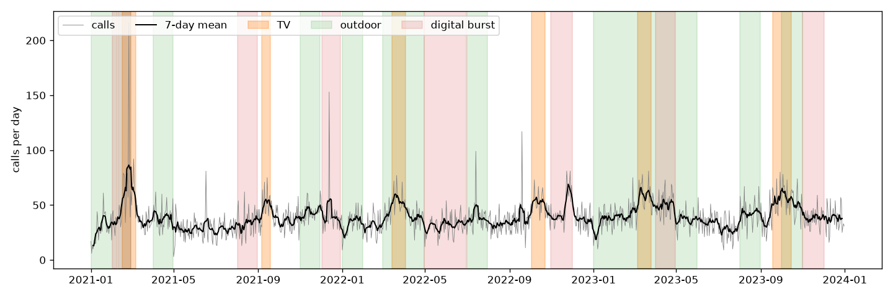
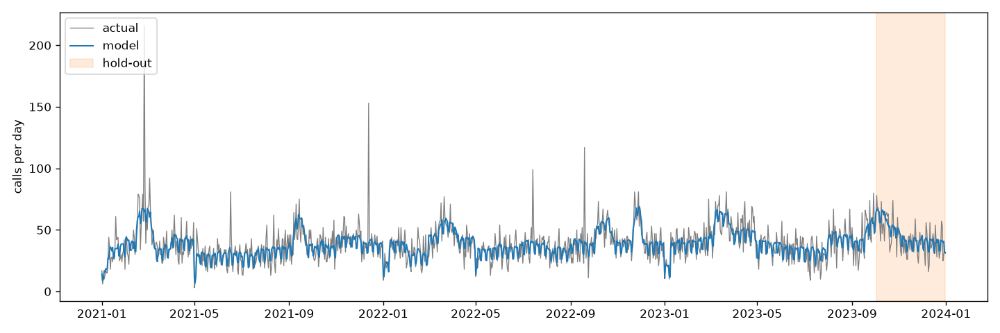
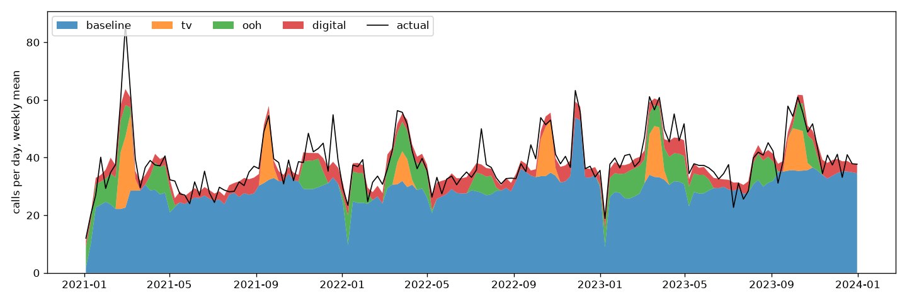
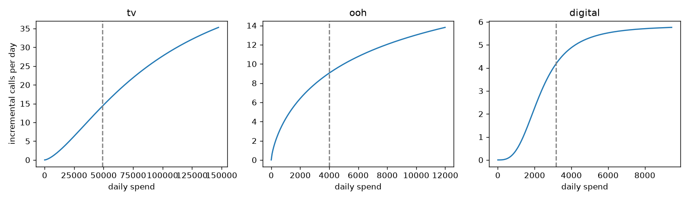

# Marketing mix modeling

Measure how TV, outdoor and digital advertising drive daily customer calls, how TV
effectiveness changes over time, and how to reallocate the media budget — with adstock
and saturation transforms, a regression model with time-based validation and
assumption tests, and a Bayesian model calibrated with lift tests, demonstrated on
simulated data with a known ground truth.

## Task

A daily time series of a business target — calls from potential buyers — and its
drivers: media activity (contacts with the target audience for TV and digital, monthly
contacts for outdoor advertising), a monthly seasonality index and a currency exchange
rate. Build a regression model that explains and predicts the target:

- exploratory analysis, including the target over time with advertising periods marked;
- a regression model validated on a separate hold-out period;
- quality and adequacy checks, tests of the model assumptions;
- quantify how the effect of TV advertising changes over time;
- plot the target together with the model's estimates;
- interpret the results, recommend improvements and additional factors.

The repository uses **simulated data** ([data/mock_daily.csv](data/mock_daily.csv)) generated by
[src/simulate.py](src/simulate.py); the true effects are stored in
[data/truth.json](data/truth.json), so the model's estimates can be checked against them.
[data/lift_tests.csv](data/lift_tests.csv) holds simulated experiment results used for
calibration.

## Data

Three years of daily data:

| Column | Meaning |
|---|---|
| `calls` | target: calls per day |
| `tv`, `ooh`, `digital` | contacts with the audience, thousands; TV runs in flights of 2–4 weeks, outdoor monthly, digital always on with bursts |
| `tv_spend`, `ooh_spend`, `digital_spend` | spend, at a fixed cost per thousand contacts per channel |
| `season` | monthly seasonality index, 0–1 |
| `fx_rate` | currency exchange rate, with one sharp depreciation |
| `holiday` | public holiday flag |

Simulated mechanism: baseline (level, trend, seasonality, weekends, holidays) + demand
pull-forward after the currency shock + each channel with adstock and Hill saturation;
TV effectiveness falls every year; negative binomial noise and a few one-day outliers.

Lift tests (`lift_tests.csv`: channel, start, end, lift, se) — experiments that measured a
channel's incremental calls over one month, e.g. by switching it off in test regions:
two for outdoor, one for digital, each with a 15 % standard error.



## Solution

1. **Exploratory analysis** ([src/eda.py](src/eda.py)) — descriptive statistics, share of
   days with exposure, spend shares, correlations; calls with advertising periods
   (above), mean calls by weekday and month.
2. **Media transforms** ([src/transforms.py](src/transforms.py)) — geometric adstock
   (carry-over, a<sub>t</sub> = x<sub>t</sub> + decay · a<sub>t−1</sub>), optionally Weibull
   adstock whose effect can peak days after exposure (`--adstock weibull`), and Hill
   saturation (diminishing returns).
3. **Model** ([src/model.py](src/model.py)):
   - adstock decay, half-saturation and shape per channel are searched with differential
     evolution on the training period, with the linear part fitted by least squares for
     each candidate and negative media effects penalised; decay ranges follow common
     practice per channel type (TV 0.3–0.8, outdoor 0.1–0.4, digital 0–0.3);
   - regression of calls on the media effects and controls: trend, seasonality index,
     holidays, weekdays and the currency shock (positive 7-day log return of the rate);
     TV gets a separate coefficient per year to measure the change of its effect;
   - two model families: OLS, and a negative binomial GLM with identity link — the same
     additive effects, but count noise whose variance grows with the mean;
   - days with residuals beyond 4 robust standard deviations get a dummy each, so one-off
     anomalies don't bias the media effects;
   - HAC (Newey–West) standard errors, robust to autocorrelation;
   - input validation: required columns, missing and negative values, consecutive days.
4. **Evaluation** ([src/evaluate.py](src/evaluate.py), [src/mmm.py](src/mmm.py)):
   - the last 90 days are held out and compared with a **baseline without media** (same
     controls), to show what the media variables add;
   - **rolling-origin cross-validation**: expanding training window, the next 90 days as
     test, hyperparameters searched again in every fold;
   - assumption tests on the training residuals: Durbin–Watson and Ljung–Box
     (autocorrelation), Breusch–Pagan (heteroscedasticity), Jarque–Bera (normality),
     VIF (multicollinearity);
   - **block bootstrap** (28-day blocks of residuals, model refitted): 95 % intervals for
     contribution shares, ROI and TV effectiveness.
5. **Decomposition and ROI** — the model is refitted on all data; daily contribution of
   each driver, share of calls per channel, incremental calls per 1000 of spend
   ([src/plots.py](src/plots.py) for the figures).
6. **Bayesian model** ([src/bayes.py](src/bayes.py)) — the same structure in PyMC, with
   all parameters, including the media hyperparameters, estimated jointly: Beta priors on
   decay centred on the usual ranges per channel type, LogNormal half-saturation, Gamma
   shape, HalfNormal media effects, negative binomial likelihood. Each lift test adds a
   likelihood term — the model's incremental calls of the channel over the test period
   ~ Normal(measured lift, se) — which is how experiments calibrate an MMM. Sampled with
   NUTS, 4 chains × 1000 draws; 95 % posterior intervals include hyperparameter uncertainty.
7. **Budget allocation** ([src/optimize.py](src/optimize.py)) — each channel keeps its
   spend pattern of the last year and is scaled by a multiplier (0.5–2×); multipliers that
   maximise incremental calls for the same total budget are found with SLSQP. Guardrails:
   channels pushed beyond their highest observed exposure are flagged (`--within-observed`
   forbids it), and the gain is evaluated over the Bayesian posterior draws.

## Results

Hold-out validation (last 90 days), OLS:

| Model | R² | RMSE | MAPE |
|---|---|---|---|
| Marketing mix model, training | 0.48 | 10.9 | 20 % |
| Marketing mix model, hold-out | **0.48** | **9.3** | **20 %** |
| Baseline without media, hold-out | 0.19 | 11.5 | 25 % |

The remaining error is the noise of the simulated counts: even the true expected calls
give RMSE 11.0 / 9.1 and hold-out R² 0.50, so the model is at the noise floor.

Rolling-origin cross-validation, 3 folds of 90 days:

| Test period starts | R² | RMSE | MAPE | Baseline R² | Baseline RMSE |
|---|---|---|---|---|---|
| day 826 | 0.42 | 9.0 | 18 % | 0.21 | 10.5 |
| day 916 | 0.49 | 10.7 | 30 % | 0.23 | 13.1 |
| day 1006 | 0.48 | 9.3 | 20 % | 0.19 | 11.5 |

The media variables about double the explained variance in every fold.



**Assumption tests** (training residuals):

| Test | OLS | Negative binomial (Pearson residuals) |
|---|---|---|
| Durbin–Watson | 2.00 | 2.00 |
| Ljung–Box, lag 7 | p = 0.17 | p = 0.26 |
| Breusch–Pagan | p < 0.001 | p = 0.83 |
| Jarque–Bera | p < 0.001 | p = 0.03 |
| Max VIF | 1.7 | 1.7 |

No autocorrelation is left and there is no multicollinearity. OLS residuals are
heteroscedastic — the variance of counts grows with the mean — which the negative
binomial model removes; both give the same effects (hold-out R² 0.48, contribution
shares within 0.002), so OLS with HAC errors is kept as the default.

**Recovery of the true effects** ([data/truth.json](data/truth.json)), OLS with 95 %
bootstrap intervals:

| | True | Estimated (95 % interval) |
|---|---|---|
| TV — share of calls | 4.8 % | 5.1 % (4.6–5.5) |
| TV — calls per 1000 spend | 0.33 | 0.35 (0.31–0.38) |
| Outdoor — share of calls | 7.9 % | 9.7 % (8.6–10.7) |
| Outdoor — calls per 1000 spend | 1.82 | 2.26 (2.01–2.51) |
| Digital — share of calls | 9.5 % | 8.9 % (5.7–11.2) |
| Digital — calls per 1000 spend | 1.15 | 1.09 (0.70–1.38) |
| TV adstock decay | 0.60 | 0.62 |
| Currency shock effect | 150 | 156 |
| Weekend effect, calls per day | −9.0 | −8.6 / −9.0 |

The ROI ranking is recovered — outdoor > digital > TV — and all contribution shares are
within about 2 percentage points. The intervals cover the truth for TV and digital, not for
outdoor: they keep the hyperparameters fixed, and outdoor decay ends at the upper limit of
its range (0.4 vs true 0.3) — with a few months of outdoor activity, carry-over is hard to
separate from the baseline. Coefficient and half-saturation trade off against each other,
so effects are compared at the observed exposure, not as raw coefficients.

**Bayesian model** — 95 % posterior intervals, without and with lift-test calibration:

| | True | Bayesian | Bayesian + lift tests |
|---|---|---|---|
| TV — share of calls | 4.8 % | 4.9 % (4.2–5.7) | 5.0 % (4.2–5.8) |
| TV — calls per 1000 spend | 0.33 | 0.34 (0.29–0.39) | 0.34 (0.29–0.40) |
| Outdoor — share of calls | 7.9 % | 9.6 % (8.3–11.0) | **8.5 % (7.4–9.7)** |
| Outdoor — calls per 1000 spend | 1.82 | 2.24 (1.93–2.57) | **2.00 (1.73–2.28)** |
| Digital — share of calls | 9.5 % | 14.5 % (4.3–34.1) | **7.7 % (4.1–11.7)** |
| Digital — calls per 1000 spend | 1.15 | 1.79 (0.53–4.21) | **0.95 (0.51–1.44)** |
| TV decay | 0.60 | 0.56 (0.36–0.71) | 0.56 (0.38–0.71) |
| Outdoor decay | 0.30 | 0.31 (0.10–0.52) | 0.29 (0.08–0.52) |
| Digital decay | 0.15 | 0.16 (0.02–0.39) | 0.13 (0.01–0.36) |
| Hold-out R² / RMSE | | | 0.48 / 9.3 |
| Convergence | | R̂ 1.00, 36 of 4000 divergent | R̂ 1.00, no divergences |

Without experiments the outdoor effect is overestimated and digital is barely identified
— an always-on channel is hard to separate from the baseline. Three lift tests pull both
towards the truth: with calibration every true value lies inside its 95 % interval, and
the intervals include the uncertainty of the decay and saturation parameters. The
hold-out fit equals the OLS model (the fit on the training period alone had 24 of 4000
divergent draws; a higher `target_accept` would reduce them).

**Weibull adstock** (`--adstock weibull`) fits slightly worse on the hold-out
(R² 0.46, RMSE 9.4) than geometric — as expected, since the simulated carry-over is
geometric — so geometric is the default.

**Change of TV effectiveness** — incremental calls per 1000 TV contacts:

| Year | True | Estimated (95 % CI) |
|---|---|---|
| 1 | 1.68 | 1.87 (1.63–2.11) |
| 2 | 1.38 | 1.28 (1.04–1.52) |
| 3 | 0.99 | 1.15 (0.93–1.37) |

The decline is significant (Wald test of equal yearly coefficients, p < 0.001): the
same TV contacts bring about 40 % fewer calls in the third year than in the first.





**Budget allocation** for the last year, same total budget (OLS model; interval over the
calibrated Bayesian posterior):

| Constraint | TV | Outdoor | Digital | Incremental calls (95 % interval) |
|---|---|---|---|---|
| 0.5–2× of current spend | 0.5× | 2.0× | 1.5× | **+18 %** (+5 % to +24 %) |
| also within observed exposure | 0.91× | 1.33× | 1.0× | **+5 %** (+1 % to +7 %) |

Without the second constraint outdoor and digital are pushed beyond the highest daily
exposure in the data, so most of the +18 % is an extrapolation of the response curves;
the +5 % within the observed range is the safer recommendation. In both cases the gain
is positive with posterior probability 0.99.

**Recommendations:**
- shift budget from TV to outdoor, within the observed range, and test higher levels of
  outdoor and digital before scaling them further;
- the effect of TV is wearing out — refresh the creative or the targeting and measure again;
- run lift tests regularly, especially for digital, and recalibrate the model with them.

**Additional factors** that would improve explanatory and predictive power: competitor
advertising and prices, own price and promotions, product launches, dealer network
size, search interest, web traffic, weather, macroeconomic indicators (consumer
confidence, credit rates), and media quality metrics (reach, frequency, creative).

## Project structure

```
marketing-mix-modeling/
├── README.md
├── requirements.txt
├── data/
│   ├── mock_daily.csv    # simulated daily data
│   ├── lift_tests.csv    # simulated lift-test results
│   └── truth.json        # true parameters and effects of the simulation
├── docs/figures/         # figures used in this README
├── src/
│   ├── simulate.py       # mock data with a known ground truth
│   ├── transforms.py     # adstock and Hill saturation
│   ├── eda.py            # exploratory analysis and plots
│   ├── model.py          # features, hyperparameter search, OLS / NB fit, tests, decomposition
│   ├── evaluate.py       # baseline, rolling CV, bootstrap intervals
│   ├── plots.py          # model figures
│   ├── mmm.py            # command line: fit, validate, report
│   ├── bayes.py          # Bayesian model with lift-test calibration (PyMC)
│   └── optimize.py       # budget allocation with guardrails
└── tests/                # pytest: transforms, simulation, recovery of the truth, Bayesian model, optimiser
```

## Usage

```sh
python -m venv .venv && source .venv/bin/activate
pip install -r requirements.txt
pytest tests

cd src
python simulate.py   # optional, data is included: mock_daily.csv, truth.json, lift_tests.csv
python eda.py --input ../data/mock_daily.csv --output ../results
python mmm.py --input ../data/mock_daily.csv --output ../results --truth ../data/truth.json \
    --cv-folds 3 --bootstrap 200          # --family nb: negative binomial; --adstock weibull
python bayes.py --input ../data/mock_daily.csv --output ../results/bayes \
    --lift-tests ../data/lift_tests.csv --truth ../data/truth.json
python optimize.py --input ../data/mock_daily.csv --model ../results/model.json \
    --posterior ../results/bayes/posterior_draws.json --within-observed
```

`mmm.py` writes `model.json` (hyperparameters, coefficients, metrics, tests, ROI,
intervals), `summary.txt` (regression summary), `cv.csv`, `truth_vs_estimate.csv` and the
figures to `--output`. The hyperparameter search takes about two minutes and is repeated
in every cross-validation fold. `bayes.py` writes `bayes.json`, `bayes_summary.csv` and
`posterior_draws.json`; with the hold-out it samples twice, about nine minutes in total.

For real data, replace the CSV with the same columns; without `--truth` the comparison
with the ground truth is skipped.
