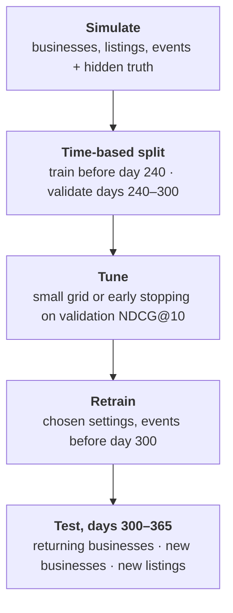
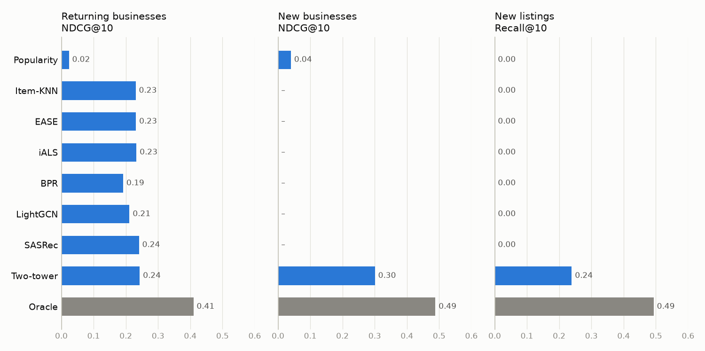

# Marketplace recommender system

Recommend commercial property listings to businesses on a two-sided rental marketplace.
Eight recommenders are compared, from popularity and item-KNN to EASE, implicit ALS, BPR,
LightGCN, SASRec and a two-tower neural model. On top of them sits a two-stage pipeline
(retrieval + LightGBM reranker) with a command-line tool for serving recommendations. All models
are tuned and tested on the same time-based split, with separate results for returning
businesses, new businesses and new listings. The data is simulated with known true preferences,
so every model is also compared with an oracle that ranks by the truth.

## Task

A marketplace connects landlords, who publish listings (retail units, offices, warehouses,
restaurants, coworking spaces), with businesses looking for space to rent. For every business,
the platform has its profile (segment, city, size, budget) and its history of views, saves and
contacts. For every listing, it has the landlord, type, city, area, rent, footfall, and the
days the listing was published and taken down.

Build a recommender that ranks the listings available next for each business:

- learn from implicit feedback (no ratings, only interactions of different strength);
- evaluate on the future, not on a random split;
- handle cold start: businesses with no history, and listings published after training;
- compare classical and modern methods on the same data and metrics.

The repository uses **simulated data** generated by [src/simulate.py](src/simulate.py). The
hidden parameters are saved in `truth.npz` and `truth.json`, so recommendations can be checked
against the true preferences.

## Data

`simulate.py` writes three tables (default: 8000 businesses, 3000 listings, 400 landlords, one
year, about 170 000 events):

| Table | Columns |
|---|---|
| `users.csv` | `user_id`, `segment` (8 business types), `city`, `employees`, `budget` (monthly rent), `signup_day` |
| `items.csv` | `item_id`, `landlord_id`, `property_type` (5 types), `city`, `area_m2`, `rent`, `footfall`, `publish_day`, `remove_day` |
| `events.csv` | `user_id`, `item_id`, `ts` (day, with fractions for order), `event` (`view`, `save`, `contact`) |

**Simulated mechanism.** The true utility of a listing for a business is the sum of:
- hidden taste (16-dimensional vectors);
- a segment × property-type affinity (cafés prefer restaurants and retail, logistics prefers warehouses);
- the city (home city; some businesses also search in a hidden second city);
- budget fit (squared log ratio of rent to budget);
- footfall, for segments that need passers-by;
- the landlord's and the listing's hidden quality.

Businesses arrive over the year and browse in sessions. Each session focuses on one property
type and one city, and the next listing viewed tends to resemble the previous one. Only
listings published at that moment can be seen. A view becomes a save or a contact with a
probability that grows with the utility. Activity per business is skewed (log-normal), and
listings stay online for a log-normal number of days.

**Preparation and split** ([src/data.py](src/data.py)):
- **Input validation:** columns, missing values, unknown ids and event types, non-positive values.
- **Interactions:** a business × listing matrix with the strongest event per pair, weighted
  view 1, save 3, contact 5, and each business's listings in time order (for SASRec).
- **Time-based split:** models learn from events before a cutoff day and are evaluated on the
  window after it, as in production, where the future is unknown. Validation: train before
  day 240, evaluate days 240–300. Test: train before day 300, evaluate days 300–365.
- **Targets:** the listings a business interacts with in the window, except listings it had
  already interacted with before the cutoff. The task is finding new listings, not repeats.
- **Candidates:** only listings online during the window can be recommended; listings the
  business has already seen are excluded from every ranking.
- **Segments:** *returning businesses* have history before the cutoff; *new businesses* have
  none; *new listings* were published inside the window, so no model has seen them in training.

## Models

| Model | Family | Learns from | New businesses | New listings |
|---|---|---|---|---|
| Popularity | non-personalised | interaction counts | ✅ same list for all | ❌ |
| Item-KNN | item similarity | interaction matrix | ❌ | ❌ |
| EASE | item-item regression | interaction matrix | ❌ | ❌ |
| iALS | matrix factorisation | weighted interaction matrix | ❌ | ❌ |
| BPR | matrix factorisation | interaction pairs | ❌ | ❌ |
| LightGCN | graph neural network | interaction graph | ❌ | ❌ |
| SASRec | sequential transformer | order of interactions | ❌ | ❌ |
| Two-tower | neural retrieval | interactions + profiles + listing features | ✅ | ✅ |
| Two-stage | retrieval + reranker | all of the above + cross features | ✅ | ✅ |

**Popularity** ([src/baselines.py](src/baselines.py)) recommends the listings that most
businesses interacted with recently (last 7 or 30 days). Everyone gets the same list. It is the
reference every personalised model has to beat, and the usual fallback for a visitor nobody
knows.

**Item-KNN** ([src/baselines.py](src/baselines.py)) works like "businesses that looked at this
listing also looked at these". Two listings are similar when the same businesses interacted
with both (cosine similarity of their columns in the interaction matrix); a business's score
for a listing is the sum of its similarities to the listings in the business's history. There is
no training and every recommendation can be explained, but a listing nobody has seen has no
similarities, and a business without history gets no scores.

**EASE** (Steck, 2019, [src/baselines.py](src/baselines.py)) also scores a listing from the
business's history, but *learns* the item-item weights: it predicts every listing's column of
the interaction matrix from all other columns with an L2-penalised regression (zero diagonal,
so a listing cannot predict itself). Unlike item-KNN, the weights are fitted jointly, so
overlapping evidence is not double-counted and weights can be negative. The solution is
closed-form, one matrix inversion, which is cheap for thousands of listings but grows with the
cube of the catalogue.

**iALS** (Hu, Koren, Volinsky, 2008, [src/mf.py](src/mf.py)) is matrix factorisation: every
business and every listing gets a vector of 64 hidden factors, and the score is their dot
product. It fits the whole matrix, treating unobserved pairs as weak negatives, with confidence
1 + α·weight, so a contact counts more than a view. It alternates between solving all business
vectors and all listing vectors, each a small least-squares problem. Compared with EASE it
compresses the data into a few factors, which scales to large catalogues.

**BPR** (Rendle et al., 2009, [src/mf.py](src/mf.py)) uses the same factor model with a
different objective: pairwise ranking. For a business, a listing it interacted with should
score higher than a random listing it did not. It is trained by stochastic gradient descent
on sampled pairs, so it optimises the order of the ranking directly instead of reconstructing
the matrix.

**LightGCN** (He et al., 2020, [src/lightgcn.py](src/lightgcn.py)) sees the data as a graph:
businesses and listings are nodes, interactions are edges. Each node's embedding is
repeatedly averaged with its neighbours' embeddings (3 layers), so a business's vector also
reflects the listings of similar businesses, several hops away. It is a graph convolutional
network stripped down to this averaging, with no weight matrices or non-linearities. It is
trained with the BPR loss; the difference from BPR is the smoothing over the graph.

**SASRec** (Kang and McAuley, 2018, [src/sasrec.py](src/sasrec.py)) treats a business's
history as a sentence and predicts the next listing, like a language model predicts the next
word. A transformer (2 layers, 2 attention heads, the last 50 listings) uses self-attention to
weigh which earlier listings matter for the next one, with a causal mask so it never looks
ahead. It is the only model that uses the order of events, so it can follow a business's
current intent (one city, one property type) rather than its average taste. It is trained with
full softmax cross-entropy over all listings, which works better than the original sampled
binary loss (Klenitskiy and Vasilev, 2023).

**Two-tower** ([src/two_tower.py](src/two_tower.py)) has two neural networks: one maps a
business (ID + segment, city, employees, budget) to a vector, the other maps a listing (ID +
type, city, landlord, area, rent, footfall) to a vector in the same space; the score is their
dot product.
- **Training:** for each business–listing pair in a batch, the other listings of the batch serve
  as negatives (in-batch softmax). A logQ correction removes the bias towards popular listings
  that this sampling creates (Yi et al., 2019).
- **ID dropout:** IDs are hidden at random 30 % of the time, so the towers also learn to work
  from features alone. That is how it ranks for new businesses and new listings, which no
  other model here can do.
- **Serving:** listing vectors can be computed in advance, and retrieval becomes a
  nearest-neighbour search, which is why this architecture is the industry standard for the
  first stage of large recommenders.

**Oracle** ranks by the true static utility of the simulation (without session effects). It
is an upper reference for what the data allows, not a model.

### Experiment

([src/run.py](src/run.py), [src/training.py](src/training.py))
- **Tuning:** small grids (popularity window, item-KNN k, EASE and iALS regularisation, iALS α);
  neural models stop early on validation NDCG@10 (patience 3).
- **Final models:** retrained on all events before the test window with the chosen settings
  and number of epochs.
- **Reproducibility:** fixed seeds; 2 PyTorch threads by default (`--threads`).



## Metrics

All metrics compare the top of each business's ranking with its targets in the evaluation window
([src/metrics.py](src/metrics.py)). A marketplace shows a short list, so the metrics look at the
first K positions only (K = 10 and 50) and are averaged over businesses.

- **Recall@K**: the share of a business's targets found in its top K. It is divided by
  min(K, number of targets), so a business with 30 targets can still reach 1 with 10 hits in
  the top 10.
- **NDCG@K** (normalised discounted cumulative gain): like recall, but a hit counts more near
  the top. A hit at position p is worth 1 / log₂(p + 1), and the sum is divided by the best
  possible sum, so 1 means all top positions are hits. The main metric for model selection.
- **Coverage@10**: the share of available listings that appear in at least one top 10. Low
  coverage means the same few listings are shown to everyone.
- **New listings Recall@10**: recall counted only over targets that are new listings, which
  measures item cold start.
- **Candidate recall** (two-stage only): the share of targets that the retrieval stage passes on
  to the reranker. The reranker can only reorder candidates, so this is its ceiling.
- **95 % interval for NDCG@10**: bootstrap over businesses, 1000 resamples; it shows how much the
  result depends on which businesses happen to be in the test window.

## Results

Test window, on mock data:
- 1361 returning businesses;
- 1155 new businesses, with no history;
- 957 listings online, 211 of them published during the window.

### Model comparison



**Returning businesses:**

| Model | Recall@10 | NDCG@10 (95 % CI) | Recall@50 | Coverage@10 | New listings Recall@10 |
|---|---|---|---|---|---|
| Popularity | 0.027 | 0.024 (0.020–0.027) | 0.114 | 0.020 | 0 |
| Item-KNN | 0.259 | 0.231 (0.220–0.241) | 0.567 | 0.571 | 0 |
| EASE | 0.259 | 0.231 (0.221–0.243) | 0.533 | 0.575 | 0 |
| iALS | 0.262 | 0.233 (0.223–0.243) | 0.562 | 0.537 | 0 |
| BPR | 0.214 | 0.192 (0.182–0.202) | 0.522 | 0.408 | 0 |
| LightGCN | 0.238 | 0.211 (0.201–0.222) | 0.545 | 0.568 | 0 |
| SASRec | 0.272 | 0.241 (0.231–0.252) | 0.577 | 0.626 | 0 |
| **Two-tower** | **0.278** | **0.243 (0.232–0.254)** | **0.642** | **0.645** | **0.239** |
| *Oracle (truth)* | *0.449* | *0.410 (0.397–0.422)* | *0.806* | *0.906* | *0.493* |

**New businesses** (no history; only feature-based models and popularity can rank for them):

| Model | Recall@10 | NDCG@10 (95 % CI) | Recall@50 | New listings Recall@10 |
|---|---|---|---|---|
| Popularity | 0.045 | 0.040 (0.035–0.045) | 0.149 | 0 |
| **Two-tower** | **0.321** | **0.301 (0.290–0.313)** | **0.677** | **0.168** |
| *Oracle (truth)* | *0.503* | *0.488 (0.477–0.502)* | *0.832* | *0.398* |

Settings chosen on validation: popularity over 30 days, item-KNN k = 200, EASE λ = 100, iALS
λ = 10 and α = 5; BPR 18, LightGCN 55, SASRec 30 and two-tower 2 epochs.

What the numbers show:
- **Popularity is a weak baseline here.** Each business searches in its own city and segment,
  so a global top list hits rarely; the personalised models are 8–10× better.
- **For returning businesses, the strong models are close.** Two-tower, SASRec, iALS, EASE and
  item-KNN lie within about 0.01 NDCG@10, and their intervals overlap; they reach 56–59 % of the
  oracle. Two-tower leads clearly on Recall@50 and coverage.
- **SASRec is the only model that uses the order of events.** In the simulation, consecutive
  listings within a session resemble each other; it ties with the two-tower model on NDCG@10.
- **LightGCN and BPR come last among the learned models.** Both train with random negatives,
  and only their number of epochs was tuned, not learning rate or regularisation. LightGCN
  improves on BPR, its plain matrix-factorisation counterpart (0.211 vs 0.192).
- **Cold start is where the two-tower model is needed.** Item-KNN, EASE, iALS, BPR, LightGCN and
  SASRec score new listings as unknown and cannot rank for businesses without history. The
  two-tower model ranks for new businesses at 62 % of the oracle (7.5× popularity), and for
  returning businesses it finds about half as many new listings as the oracle (0.239 vs 0.493).
- **The two-tower model peaks after 2 epochs:** validation NDCG@10 fell in the following
  epochs, so early stopping kept epoch 2.

### Two-stage pipeline

The pipeline ([src/two_stage.py](src/two_stage.py)) combines a fast first stage that finds a
few hundred plausible listings with a slower, more precise second stage that orders them.
- **Retrieval:** the two-tower top 200, plus the EASE top 100 for businesses with history.
- **Reranking:** LightGBM with the LambdaRank objective, which optimises NDCG directly. It
  scores every candidate pair with features a dot product cannot express: rent relative to the
  business's budget, whether the listing is in the business's city, how much of the business's
  history has the same type, city or landlord, rent against the history's average, listing
  popularity and age, and the retrieval scores and ranks.
- **No leakage:** the reranker learns on the validation window from retrieval models trained
  before it; retrieval is then retrained before the test window.

On mock data, same test window. The reranker learned on the validation window (406 948
candidate pairs, 14 812 of them targets) and stopped early at 125 trees, judged on a held-out
fifth of the validation businesses.

**Two-stage pipeline model: Two-tower + EASE → LightGBM LambdaRank**

| Metric | Returning businesses | New businesses |
|---|---|---|
| Recall@10 | 0.349 | 0.367 |
| NDCG@10 (95 % CI) | 0.307 (0.295–0.320) | 0.341 (0.328–0.354) |
| Recall@50 | 0.717 | 0.724 |
| Coverage@10 | 0.676 | 0.506 |
| New listings Recall@10 | 0.220 | 0.121 |
| Candidate recall | 0.939 | 0.933 |

Compared with the two-tower model alone (tables above):

- **Reranking adds most where it matters.** NDCG@10 rises by 26 % for returning businesses
  (0.243 → 0.307, intervals do not overlap) and by 13 % for new businesses (0.301 → 0.341):
  75 % and 70 % of the oracle, against 59 % and 62 % for the two-tower model alone.
- **Retrieval is not the bottleneck:** 94 % of the targets are among the candidates, so the
  gain comes from ordering them better.
- **What the ranker uses** (share of LightGBM gain): two-tower rank 45 %, listing age 16 %,
  two-tower score 15 %, popularity 5 %; city match, rent vs budget, footfall, EASE score and
  history shares 1–3 % each.
- **The price is fewer new listings in the top 10** (0.239 → 0.220 for returning businesses,
  0.168 → 0.121 for new ones): new listings have no popularity yet, one of the features the
  ranker relies on. A production system would reserve some slots for new listings.
- `two_stage.py` retrains the two-tower model itself and gets the same scores as the model
  comparison above (same model and seed), which checks reproducibility.

Limitations: the simulation decides how informative features and order are, so the ranking of
methods applies to this mechanism, not to every marketplace. Results are from one simulation
seed and one training seed, and the neural models were not given a full hyperparameter search.

## Serving

[src/two_stage.py](src/two_stage.py) saves the serving model: retrieval retrained on all
events, the ranker learned on the validation window, and `meta.json` with the settings,
training cutoff, feature list, test metrics and library versions.
[src/recommend.py](src/recommend.py) loads it and ranks the listings online on a given day that
the business has not seen yet, with optional filters by city, property type and maximum rent.
Businesses without history are ranked from their profile.

```sh
python recommend.py --data ../data --model-dir ../models --user u00042 --max-rent 8000
```

```
u00042: fitness, harbor, 28 employees, budget 8180, 6 listings in history; day 365

item_id property_type   city  area_m2   rent landlord_id  score
 i02794        retail harbor    109.0 4870.0       l0247  1.089
 i01876        retail harbor    130.0 4760.0       l0140  0.858
 i00717        retail harbor    173.0 7830.0       l0354  0.819
 i02118        retail harbor    131.0 4070.0       l0200  0.662
 i00691        retail harbor     86.0 4150.0       l0313  0.588
 i02804        retail harbor    138.0 7160.0       l0393  0.224
 i00803        retail   east    116.0 5110.0       l0010  0.156
 i01620    restaurant harbor    119.0 6290.0       l0026  0.111
 i00422        retail harbor    104.0 5230.0       l0236  0.096
 i01987        retail harbor     93.0 4770.0       l0056  0.001
```

A fitness business in the harbor city gets retail units in its city within its budget, plus
one in another city and one restaurant space further down.

## Project structure

```
marketplace-recommender-system/
├── README.md
├── requirements.txt
├── docs/figures/       # figure used in this README
├── src/
│   ├── simulate.py     # mock marketplace with hidden true preferences
│   ├── data.py         # loading, validation, time-based split, features
│   ├── metrics.py      # Recall@K, NDCG@K, coverage, new-listing recall
│   ├── training.py     # shared PyTorch loop with early stopping
│   ├── baselines.py    # popularity, item-KNN, EASE, oracle
│   ├── mf.py           # iALS, BPR
│   ├── lightgcn.py     # LightGCN
│   ├── sasrec.py       # SASRec
│   ├── two_tower.py    # two-tower model with ID dropout and logQ correction
│   ├── run.py          # model comparison: tuning, retraining, evaluation, figure
│   ├── two_stage.py    # retrieval + LightGBM reranker; evaluation; saves the serving model
│   └── recommend.py    # recommendations for one business from the saved model
└── tests/              # pytest: simulation, split leakage, metrics, every model beats random,
                        #         two-stage save/load, recommendation filters
```

## Usage

```sh
python -m venv .venv && source .venv/bin/activate
pip install -r requirements.txt
pytest tests

cd src
python simulate.py --output ../data --seed 42
python run.py --data ../data --output ../results --truth ../data/truth.npz
# a subset: --models EASE iALS Two-tower; more PyTorch threads: --threads 4
python two_stage.py --data ../data --output ../results --model-dir ../models \
    --settings ../results/settings.json
python recommend.py --data ../data --model-dir ../models --user u00042 --max-rent 8000
```

- `run.py` writes `results.csv` (all metrics per model and segment), `settings.json` (chosen
  settings) and `comparison.png`. The slowest steps are SASRec and LightGCN training, each run
  twice (validation and test). Without `--truth` the oracle is skipped, so the same command
  works on real data in the same three-table format.
- `two_stage.py` writes `two_stage.csv` and `ranker_importance.csv`, and saves the serving model
  to `--model-dir`: `two_tower.pt`, `ranker.txt` (LightGBM) and `meta.json` (settings, cutoff,
  features, test metrics, library versions). The serving model's retrieval is retrained on all
  events; EASE is refitted from the data on load.
