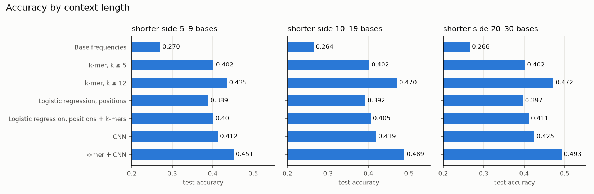

# Masked nucleotide prediction

Predicts a missing base in a DNA sequence from 5–30 known bases on each side. Context-count
(k-mer) models are built over 88 million bases in seconds with numpy and parallel numba, using
all CPU threads. They are compared with logistic regression and a small CNN, on genes the models
have never seen.

## Task

A DNA sequence consists of the letters A, C, G and T. One letter is missing, and 5–30 known
letters are given on each side of the gap, for example:

```
CGTAACGTGAACATCTTTAAATTC_TCATTCCTAATGTTGTAAAATACAGCCCGA   →   A
```

Given a FASTA file of gene sequences:
- prepare training data;
- build a model that predicts the missing letter;
- evaluate it with suitable metrics.

Leading `N` characters in a sequence may be removed. The solution is in Python.

The data is an [Ensembl BioMart](https://www.ensembl.org/biomart) export of human coding
sequences, one record per transcript, with headers
`>gene_id|gene_id.version|transcript_id|transcript_id.version`. It is not included in this
repository. Ensembl places
[no restrictions](https://www.ensembl.org/info/about/legal/disclaimer.html) on use of its data.

## Data preparation

1. **Reading** ([src/genome.py](src/genome.py)): FASTA lines are joined into one sequence per
   record. Leading `N` are stripped. Records that are unavailable or have other letters inside
   are dropped, which leaves 102,020 of 249,158 transcripts.
2. **Split by gene:** 70 % of genes for training, 10 % for validation and 20 % for test. A gene
   usually has several transcripts that share long stretches of sequence. A random split by
   sequence or by line would put near-copies of test windows into the training data. Validation
   and test keep one transcript (the longest) per gene, so genes with many transcripts are not
   counted many times.
3. **Encoding:** each split is one `uint8` array with A=0, C=1, G=2, T=3, and a separator 4 between
   sequences, so that no context crosses from one sequence into another. That is 88.5M training
   bases, 3.8M for validation and 7.7M for test.
4. **Examples** ([src/windows.py](src/windows.py)): a position is drawn uniformly. The left and
   right context lengths are drawn independently from 5–30 and cut where the sequence ends. An
   example is a 61-wide window centred on the hidden base, with "unknown" outside the context.

## Models

| Model | File | Idea |
|---|---|---|
| Base frequencies | — | always predicts the most frequent base (G) |
| k-mer, k ≤ 5 | [kmer_model.py](src/kmer_model.py) | how often each base occurs between the same k left and k right neighbours, k = 1…5 |
| k-mer, k ≤ 12 | [kmer_model.py](src/kmer_model.py) | the same with k = 6, 7, 8, 10, 12 added |
| Logistic regression, positions | [linear_model.py](src/linear_model.py) | one-hot base at each of the 60 context positions |
| Logistic regression, positions + k-mers | [linear_model.py](src/linear_model.py) | also the joint code of the 1, 2 and 3 nearest neighbours on each side |
| CNN | [cnn_model.py](src/cnn_model.py) | three 1D convolutions (dilation 1, 2, 4) and a dense head, on the one-hot window |
| k-mer + CNN | [evaluate.py](src/evaluate.py) | weighted average of the two probability outputs |

**The k-mer model** smooths each order towards the one below it:
`p_k = (counts_k + alpha * p_(k-1)) / (n_k + alpha)`. A context never seen in training keeps the
shorter context's estimate. Each example uses only the orders that fit into its shorter context
side.

**Counting** ([src/counting.py](src/counting.py)): there are two kinds of table.
- For k ≤ 5, the contexts fit dense tables (4^10 rows). They are filled in one parallel numba
  pass: each thread counts its share of the bases into its own table, and the tables are summed.
- For k ≥ 6, there are up to 4^24 possible contexts, but only about 25M occur. numba writes the
  context code of every position in parallel. A parallel bucket sort follows: codes are scattered
  into 1,024 buckets by their leading bits, and the buckets are sorted on all threads at once.
  One pass then counts equal codes, and lookups use `np.searchsorted`.

**Tuning on validation genes:**
- the highest k and alpha by log-loss (alpha 32 and k up to 12 were chosen; all values are in
  [results/kmer_tuning.csv](results/kmer_tuning.csv));
- C for logistic regression (0.1 for both feature sets), trained on 1M examples;
- the CNN's best checkpoint (Adam, 4,000 steps of 1,024 freshly drawn examples);
- the blend weight (0.6 for the k-mer model).

## Results

On 200,000 test examples from the 4,697 test genes:

| Model | Accuracy (± 95 %) | Log-loss | Training time (k-mer model = 1) |
|---|---|---|---|
| Base frequencies | 0.267 ± 0.002 | 1.383 | — |
| k-mer, k ≤ 5 | 0.402 ± 0.002 | 1.280 | 1 (all orders built together) |
| **k-mer, k ≤ 12** | **0.458 ± 0.002** | **1.198** | 1 (all orders built together) |
| Logistic regression, positions | 0.392 ± 0.002 | 1.279 | ~0.6 |
| Logistic regression, positions + k-mers | 0.405 ± 0.002 | 1.262 | ~4 |
| CNN (on CPU) | 0.418 ± 0.002 | 1.241 | ~31 |
| **k-mer + CNN** | **0.476 ± 0.002** | **1.171** | ~32 |

The best single model is also one of the cheapest to build: the k-mer model only counts, with no
training loop.



- **Long contexts matter most.** Counting contexts of up to 12 + 12 bases raises accuracy from
  0.402 to 0.458. A long context is rarely seen in training: in a validation check, only 12 % of
  examples had a 10 + 10 base context that also occurs in the training genes. When one does
  match, it most likely comes from a related gene with a similar sequence.
- **Model comparison:**
  - Logistic regression is close to the short k-mer model: a linear model on one-hot positions
    cannot use interactions between neighbours, and the k-mer features help only a little;
  - the CNN learns local patterns better than both but cannot memorise rare long contexts;
  - blending the two is the best model.
- **Context length:** examples whose shorter side has only 5–9 bases cannot use long contexts,
  so all models are weaker there (0.45 for the blend against 0.49 with 10 or more bases).
- **By base,** T is the hardest (recall 0.36 for the blend, against 0.46–0.54 for A, C and G).
  Full metrics are in [results/metrics.csv](results/metrics.csv).

The task's example, with the k-mer model fitted on the whole file
([src/predict.py](src/predict.py)):

```
CGTAACGTGAACATCTTTAAATTC_TCATTCCTAATGTTGTAAAATACAGCCCGA
  predicted A  (A 0.90, T 0.05, G 0.03, C 0.02)
```

The example sequence occurs in 16 transcripts in the file, so this shows the tool working, not
its accuracy.

## Speed

Building the count tables from the 88.5M training bases ([src/benchmark.py](src/benchmark.py),
raw timings in [results/benchmark.csv](results/benchmark.csv)). Speed is relative to the plain
Python loop for the same step; parallel runs used 8 threads on 4 CPU cores.

| Step | Method | Speed vs plain Python | Peak memory |
|---|---|---|---|
| Encode to integers | Python loop | 1× | |
| | numpy lookup table | **~15×** | |
| Dense table, k = 5 | Python loop | 1× | |
| | numpy (sliding window + `bincount`, in 10M chunks) | ~11× | 1.4 GB |
| | numba | ~20× | 0.23 GB |
| | numba parallel | **~110×** | 0.35 GB |
| Sparse table, k = 10 | Python loop + dict | 1× | |
| | numpy (sliding window + `np.unique`) | ~13× | 4.3 GB |
| | numba + `np.unique` | ~37× | 3.0 GB |
| | numba parallel + bucket sort | **~130×** | 3.5 GB |

The plain Python versions were timed on 2M bases (5,000 sequences for encoding) and scaled to the
full data; on the full data they would also need far more memory. Peak memory includes about
0.2 GB for Python and the loaded bases.

- **numba compiles the same loop as the plain Python version:** about 20× faster for the dense table
  and 37× for the sparse one. Compiling takes under a second.
- **numpy is fast but builds large temporary arrays:** a code for every window, then a sort. numba
  writes each code straight into the table, so the dense table needs about 6× less memory.
- **Running the numba loops in parallel** adds a further 3–6× (see below).
- **Building the whole k-mer model** (all ten orders) became about 4.5× faster than with one-core
  numba.

### Parallel numba

The counting loops in [src/counting.py](src/counting.py) run on all CPU threads with numba's
`prange`, which splits a loop's iterations between threads.

- **Dense tables** (`count_all_parallel`): the bases are cut into one chunk per thread. Each thread
  counts its chunk into its own table, so no two threads ever write to the same counter and no
  locks are needed. At the end the tables are added up. The cost is one extra table per thread,
  about 18 MB each for k = 1–5.
- **Sparse tables** (`count_sparse_parallel`) work in four steps:
  1. every thread writes the context codes of its positions;
  2. each thread counts how many of its codes fall into each of 1,024 buckets, taken from the
     codes' leading bits;
  3. the counts give every thread its own place in every bucket, and each thread copies its codes
     there, again with no shared writes;
  4. the buckets are sorted at the same time, one per thread, and since the buckets are in order
     the whole array is then sorted. A last pass counts equal codes.

  This replaces numpy's `np.unique`, whose sort runs on one core.
- **Same results:** the tests check that the parallel versions give exactly the same counts as the
  plain Python, numpy and one-core numba versions.

**Number of threads.** numba uses one thread per logical CPU by default. Set it with the
`NUMBA_NUM_THREADS` environment variable:

```sh
NUMBA_NUM_THREADS=4 python src/evaluate.py --input $DATA --output results
```

Measured with 8 threads on 4 cores:

| Step | Parallel vs one thread |
|---|---|
| Dense table, k = 5 | ~5.6× faster |
| Dense tables, k = 1–5 in one pass | ~16× faster |
| Sparse table, k = 10 | ~3.6× faster |

The one-thread version for k = 1–5 keeps its tables in a numba typed list, a slower structure. So
that row combines the parallel speed-up with a faster table layout. The sparse step gains less,
probably because copying codes into buckets is limited by memory speed rather than by the CPU;
this was not profiled. The speed-ups depend on the number of cores.

**What is not parallel:**
- reading the FASTA file;
- looking up contexts when predicting (numpy);
- fitting logistic regression (scikit-learn).

The CNN uses PyTorch's own threads.

**Heat:** long runs on all threads can make a laptop CPU very hot, and it may slow itself down.
Fewer threads keep it cooler, at some cost in speed.

## Not done

- **Asymmetric contexts:** when one side is much longer than the other, the k-mer model uses
  only the shorter length on both sides.
- **The CNN was still improving slowly at 4,000 steps** (validation log-loss 1.267 → 1.246).
  Longer training on a GPU, or a transformer, would likely help.
- **The training set keeps all transcripts of each gene,** so shared sequence is counted
  several times.

## Project structure

```
masked-nucleotide-prediction/
├── README.md
├── requirements.txt
├── results/              # metrics, tuning, benchmark, figure, CNN weights (written by the scripts)
├── src/
│   ├── genome.py         # read FASTA, clean, split by gene, encode
│   ├── windows.py        # masked examples with 5–30 bases of context, query parsing
│   ├── counting.py       # context counting: Python, numpy, numba; dense and sparse tables
│   ├── kmer_model.py     # smoothed k-mer model, k = 1…12
│   ├── linear_model.py   # logistic regression on one-hot features
│   ├── cnn_model.py      # 1D CNN (PyTorch)
│   ├── evaluate.py       # train, tune on validation, report on test
│   ├── benchmark.py      # time and memory of the counting step
│   └── predict.py        # predict the gap in given sequences
└── tests/                # pytest on random sequences, no data needed
```

## Usage

```sh
python -m venv .venv && source .venv/bin/activate
pip install -r requirements.txt
pytest tests                                                     # a few seconds

DATA=path/to/genes.fa                                            # the BioMart FASTA export
python src/evaluate.py --input $DATA --output results            # slowest step: CNN training on CPU; several GB of RAM
python src/evaluate.py --input $DATA --output results --cnn-weights results/cnn_weights.pt   # reuse the trained CNN
python src/benchmark.py --input $DATA --output results
python src/predict.py --input $DATA CGTAACGTGAACATCTTTAAATTC_TCATTCCTAATGTTGTAAAATACAGCCCGA
```

Scripts are run from the project folder. On Intel Macs, the newest PyTorch and numba builds are
not available. There, use `pip install "torch<=2.2.2" "numba<0.61" "numpy<2"`; the results above
were produced with these versions.
