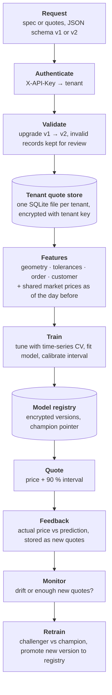

# Metal profile pricing engine

A prototype that learns each manufacturer's pricing from their historical quotes for custom
aluminium extrusion profiles. It quotes new profiles with a 90 % price interval and keeps
learning from new quotes. Each manufacturer (tenant) has isolated, encrypted storage and
models. The engine has a REST API, time-based validation, Bayesian hyperparameter tuning,
conformal intervals, versioned models, drift monitoring and champion/challenger
retraining. It is demonstrated on simulated data with a known pricing mechanism.

## Task

Extruders and other makers of custom metal profiles quote every order individually. The
price depends on the metal market, the alloy and finish, how hard the cross-section is to
extrude, how tight the tolerances are, the order size, the customer and the lead time.
Experienced estimators know these relationships, but a company's past quotes contain them
too. This project explores how far a model learned from those quotes can go as a quoting
assistant, and what it takes to run one as a service for several manufacturers at once.

The aim was a small but complete system rather than a notebook:

- a quote format that can describe any profile cross-section and its tolerances, and that
  can evolve without breaking stored history;
- per-manufacturer models that are evaluated honestly over time, compared with simple
  baselines, and broken down by where they fail;
- a price with an interval, not just a number, so an estimator can see when to check by
  hand;
- separate, encrypted data and models per manufacturer, behind an API;
- a feedback loop that notices when prices drift and retrains only when that helps.

The repository uses **simulated data** in [data/](data/), generated by
[src/pricing_engine/simulate.py](src/pricing_engine/simulate.py). The true pricing mechanism
is in [data/truth.json](data/truth.json), and each quote's expected price is in
[data/truth_prices.csv](data/truth_prices.csv).

## Data

| File | Content |
|---|---|
| `lme.csv` | daily aluminium market price (USD/t) on trading days, 2022-01 – 2025-10 |
| `quotes_tenant_a.jsonl` | 900 quotes, 2023-01 – 2025-06, **schema v1**, plus 4 invalid records |
| `quotes_tenant_b.jsonl` | 600 quotes, 2023-07 – 2025-06, **schema v2** (with GD&T), plus 4 invalid records |
| `feedback_tenant_a.jsonl` | 200 later quotes of tenant A (2025-07 – 2025-10) after a conversion-cost increase |

A quote record (v2) is nested JSON:

| Block | Fields |
|---|---|
| `customer` | `customer_id` (120 / 70 customers, Zipf-distributed), `segment` (oem, distributor, construction; 8 % missing) |
| `material` | `alloy` (6060, 6063, 6005A, 6082), `finish` (mill, brushed, anodised, powder_coated; 3 % missing) |
| `geometry` | `cross_section` (`outer` polygon and `holes` polygons in mm), `min_wall_mm`, `length_mm`, `profile_type` (label) |
| `manufacturing` | `quantity_pcs`, `linear_tol_mm` (null = standard), `gdt` (`flatness_mm`, `straightness_mm_per_m`, `twist_deg_per_m`, null = standard), `new_die` |
| `commercial` | `lead_time_days` (5 % missing) |
| target | `quoted_price_per_kg` (USD) |

Schema v1 has no `gdt` block and calls the linear tolerance `tolerance_mm`.

Profiles are generated from eight parametric families: bar, rectangular tube, round tube,
angle, channel, T, multi-chamber hollow and heat sink.

Simulated mechanism (price per kg):

> metal + margin · customer · rush · (conversion · complexity · tolerance + finish + setup)

- **metal**: 1-month mean market price + regional premium + alloy premium;
- **complexity** grows with perimeter / area, the number of hollows, walls thinner than
  2.5 mm, sections larger than 120 mm and concavity;
- **tolerance**: +12 % for each halving of the linear tolerance below standard, and +6 %
  for each halving of a GD&T tolerance;
- **finish**: treatment price per m² × outer surface per kg;
- **setup**: setup cost, plus a new die if needed (more with hollows), divided by the
  order weight;
- **rush**: a premium for lead times under 21 days;
- **customer**: a segment factor and a discount per customer.

Noise is log-normal (σ = 3.5 %). About 1.5 % of quotes are outliers (×1.5–2.2 or ×0.55–0.75).
The two tenants differ in cost base, margin, customers and history. The feedback batch has
a 25 % higher conversion cost.

## Solution

1. **Schema and validation** ([schema.py](src/pricing_engine/schema.py)). Pydantic models
   per schema version enforce:
   - enums, ranges and id patterns;
   - polygon size limits (at most 400 vertices and 20 holes);
   - no unknown fields and no future dates.

   `upgrade()` converts v1 records to v2. Storage keeps each record as received, and
   records are upgraded on read, so adding a version means a new model class and one
   upgrade step, with no data migration. Invalid records are kept with the reason (as
   `field.path: message`) for review.
2. **Storage and multi-tenancy** ([storage.py](src/pricing_engine/storage.py),
   [security.py](src/pricing_engine/security.py)):
   - one SQLite file and one directory per tenant (0700 / 0600 permissions);
   - records are encrypted with the tenant's key; only id, date and version stay in clear,
     indexed for retrieval by date;
   - per-tenant keys are derived with HKDF from a master key, which comes only from the
     environment;
   - API keys are random 256-bit tokens; only their SHA-256 hash is stored, and comparison
     is constant-time;
   - the tenant is resolved from the API key, never taken from the request, and tenant
     ids are restricted to a safe pattern (no path traversal).

   Market data is public and shared by all tenants.
3. **Features** ([geometry.py](src/pricing_engine/geometry.py),
   [market.py](src/pricing_engine/market.py), [features.py](src/pricing_engine/features.py)).
   The cross-section is a polygon with holes, the most general representation a drawing or
   CAD export gives. Complexity features are proxies for extrusion design-for-manufacturing
   rules:
   - area → weight per metre;
   - circumscribing circle diameter → press size;
   - perimeter / area → die load and extrusion speed;
   - number of hollows → bridge dies;
   - solidity (area / convex hull area) → fins and deep channels;
   - CCD / minimum wall → risk of distortion;
   - outer surface per kg → finish cost;
   - number of vertices.

   Each tolerance becomes a *tightness*, log₂(standard / specified): 0 at the standard
   (a simplified rule where the linear tolerance grows with section size), +1 for each
   halving. A count of tight GD&T callouts is added. Order features are weight and
   1 / weight (fixed costs spread over the order). Market features are the previous day's
   price, 1- and 3-month moving averages, the 1-month return and volatility, taken strictly
   *before* the quote date.
4. **Preprocessing** ([model.py](src/pricing_engine/model.py)):
   - **Missing tolerances** mean "standard" on a drawing, so they get tightness 0 by that
     rule, not a statistical imputation.
   - **Other missing values** (lead time, finish, segment) are left to the gradient-boosted
     trees. They learn on which side of each split missing values belong, which avoids the
     bias of mean imputation and keeps "missing" as a signal. The linear baseline uses
     median imputation with missing indicators.
   - **Customer ids** (high cardinality, many rare customers) are target-encoded with
     cross-fitting and shrinkage towards the global mean. Low-cardinality categories are
     handled natively by the trees.
   - **Outliers** are detected from residuals, not per column: a high price per kg is
     normal for a small complex order and abnormal for a large simple one. Quotes whose
     out-of-fold residual is beyond 4 robust standard deviations (MAD) are dropped from
     training, never from evaluation. Dropping them lowered the hold-out error compared
     with keeping them.
5. **Model** ([model.py](src/pricing_engine/model.py)). Histogram gradient boosting, the
   usual strong choice for tabular data of this size. Neural networks for tabular data
   rarely beat it with a few hundred quotes per tenant, and are harder to tune and
   explain. The target is
   log(price per kg − 1-month metal reference): metal passes through one to one, also at
   market levels the trees have never seen. Log errors are relative errors, matching MAPE.
   Everything learned from data (encoders, outlier flags, interval calibration) is fitted
   inside the training window.
6. **Validation and tuning** ([training.py](src/pricing_engine/training.py)):
   - The latest 20 % of quotes is the hold-out test set; a day's quotes are never split
     between train and test.
   - Hyperparameters are tuned with Bayesian optimisation (Optuna TPE, 40 trials) using
     4-fold expanding-window time-series CV on the training part only.
   - Two baselines run on the same split: a cost-plus rule (metal + median margin per
     profile type) and a ridge regression on the same features.
   - Metrics ([evaluate.py](src/pricing_engine/evaluate.py)):
     - MAPE: relative error per quote, how estimators judge a price;
     - median APE;
     - WAPE: error weighted by order value, i.e. the money at stake;
     - RMSE in USD/kg and R²;
     - bias and share of under-priced quotes;
     - interval coverage and width.

     Errors are also broken down by profile type, order size, finish and segment.
   - With `--truth`, the report adds the *noise floor*: the error of the simulation's true
     expected price on the same quotes, the best any model can reach.
7. **Uncertainty and final price** ([model.py](src/pricing_engine/model.py)). Split
   conformal prediction:
   - the model is fitted on the earlier 80 % of the training window;
   - its absolute log errors on the latest 20 % give a factor *q*;
   - the interval is [price / e^q, price · e^q].

   It covers 90 % of new quotes if they resemble the calibration quotes, with no assumption
   about the noise distribution. The model is then refitted on the whole window.
   Conformalized quantile regression was tried: it gave the same coverage with intervals
   about twice as wide.

   The **final price** is the point prediction, an estimate of the median price: a quote
   is equally likely to be under- or over-priced. Under-pricing loses margin on a won
   order, while over-pricing loses the order. A tenant that weighs one cost more can quote
   a point inside the interval instead; the interval shows the range of prices the tenant
   has accepted for similar profiles.
8. **Model management** ([storage.py](src/pricing_engine/storage.py)):
   - versions `v0001, v0002, …` with `metadata.json`: parameters, features, data range,
     hold-out metrics, library versions;
   - a `champion.json` pointer to the version in use;
   - models are pickled and encrypted with the tenant key; Fernet authenticates the file
     before it is unpickled, so a tampered or foreign file is rejected before any code
     could run.
9. **API** ([api.py](src/pricing_engine/api.py)), FastAPI:
   - `POST /quote` takes a spec of either schema version and returns the price per kg, the
     90 % interval, the price per piece, the order total and the model version;
   - `POST /feedback`, `GET /monitoring`, `POST /retrain`, `GET /models`, `GET /health`;
   - API key in `X-API-Key`, validation errors as 422, batches up to 1000 quotes, an
     access log without data values.
10. **Continuous learning and drift** ([training.py](src/pricing_engine/training.py)):
    - **feedback**: each new quote is schema-validated, then scored by the champion. The
      prediction is logged for monitoring. A price more than 3× off the estimate is
      rejected as a likely entry error; the rest is stored. Re-sent quotes are ignored as
      duplicates.
    - **monitoring**: retraining is triggered by 50 new quotes, by recent MAPE above
      1.5 × the hold-out MAPE, or by recent interval coverage below 80 %, all measured on
      the current champion's predictions.
    - **retraining** (champion/challenger): the challenger keeps the champion's
      hyperparameters (`--trials N` re-tunes). It is trained on everything up to the
      middle of the new window, and both models are scored on the later half. The
      challenger is promoted only if it is not worse, then refitted on all quotes.

    Everything runs in the tenant's store with the tenant's key.



## Results on mock data

Hold-out = the latest 20 % of each tenant's quotes, model tuned on the earlier 80 %:

| Tenant A (v1, 720 train / 180 test) | MAPE | MdAPE | WAPE | RMSE | R² | Bias | 90 % coverage | Interval width |
|---|---|---|---|---|---|---|---|---|
| **Model** | **5.0 %** | 3.6 % | 4.9 % | 0.66 | 0.885 | +0.5 % | 0.91 | ±11 % |
| Model, log-price target | 5.4 % | 3.8 % | 4.5 % | 0.68 | 0.877 | +0.6 % | 0.93 | ±12 % |
| Ridge, same features | 6.8 % | 5.6 % | 7.0 % | 0.78 | 0.841 | +0.6 % | | |
| Cost-plus rule | 16.1 % | 13.5 % | 15.7 % | 1.90 | 0.047 | +0.4 % | | |
| True expected price (noise floor) | 3.0 % | 2.0 % | 2.4 % | 0.65 | 0.888 | −0.2 % | | |

| Tenant B (v2, 479 train / 121 test) | MAPE | MdAPE | WAPE | RMSE | R² | Bias | 90 % coverage | Interval width |
|---|---|---|---|---|---|---|---|---|
| **Model** | **6.0 %** | 4.3 % | 6.1 % | 0.60 | 0.940 | +1.8 % | 0.94 | ±17 % |
| Model, log-price target | 6.8 % | 5.2 % | 5.0 % | 0.65 | 0.931 | +1.8 % | 0.92 | ±15 % |
| Ridge, same features | 7.0 % | 5.0 % | 5.5 % | 0.74 | 0.910 | +1.0 % | | |
| Cost-plus rule | 20.0 % | 18.0 % | 19.7 % | 2.39 | 0.057 | +2.6 % | | |
| True expected price (noise floor) | 3.2 % | 2.5 % | 3.0 % | 0.31 | 0.984 | +0.3 % | | |

- **Accuracy.** The noise floor of these quotes is 3.0–3.2 % MAPE: even the true expected
  price misses the quoted one by that much, so a lower error would mean fitting noise. The
  model reaches 5–6 % MAPE: three times better than the cost-plus rule and 14–26 % better
  than ridge regression, with 479–720 training quotes.
  RMSE and R² are close to the noise floor for tenant A because the outliers in the test
  set dominate the squared error. MAPE and WAPE show the remaining gap better.
- **Intervals.** They cover 91–94 % of test quotes for a 90 % target.
- **Bias.** Overall bias is small for tenant A (+0.5 %). For tenant B it is slightly
  positive (+1.8 %, over-pricing), and largest for round tubes (+7.2 %), small orders
  (< 250 kg: +5.4 %) and channels (+4.1 %), groups with only 11–19 test quotes.
  Systematic over-pricing loses orders in a segment, while under-pricing loses margin on
  every order won. So per-group bias, not overall MAPE, is what to check before relying on
  the model for a segment.
- **Errors by group** (in the JSON report, `--output`):
  - tenant A is hardest on bars (6.8 % MAPE): simple sections where fixed costs dominate;
  - tenant B is hardest on round tubes (10.6 %), channels (9.4 %) and quotes with an
    unknown finish (14.4 %, 8 quotes): the finish drives the price, and it is missing.
- **Target.** The margin target beats the log-price target for both tenants (by 0.4 and
  0.8 percentage points).

**Continuous learning** — tenant A receives 200 later quotes after its conversion costs rose
25 %:

| | MAPE | Bias | Under-priced | 90 % coverage |
|---|---|---|---|---|
| Champion v1 on its last 50 feedback quotes | 8.8 % | | | 0.68 |
| Champion v1 on the later half of the new window (101 quotes) | 9.9 % | −9.6 % | 95 % | 0.63 |
| Challenger on the same quotes | **6.7 %** | +0.9 % | 37 % | 0.95 |

All three triggers fired:
- 200 new quotes;
- recent MAPE 8.8 % > 1.5 × 5.0 %;
- coverage 0.68 < 0.80.

The drifted champion under-prices almost every quote by about 10 %, which is margin lost
on every order won. The challenger was promoted as v2. After promotion, monitoring starts
again from the new champion and nothing triggers.

**Limitations:**
- The data is simulated, so results show that the pipeline recovers a known mechanism,
  not how it performs on real quotes.
- The polygon is supplied by the client; parsing CAD files (DXF/STEP) is not included.
- Minimum wall thickness is an input, not computed from the polygon.
- The standard tolerance rule is simplified, not taken from a standard.
- The conformal interval has the same relative width for every quote. Coverage holds on
  average, but it is lower for some groups (0.63–0.86, e.g. unknown finish, channels,
  multi-chamber profiles).
  Calibration per segment (Mondrian conformal) would fix this with more data.
- Win/loss outcomes are not modelled; the training data are the quoted prices themselves.
- Security is a prototype:
  - the master key comes from an environment variable instead of a KMS;
  - there is no TLS (expected at a reverse proxy) and no rate limiting;
  - SQLite with one file per tenant fits one host; a fuller system would use one schema
    or database per tenant in PostgreSQL with row-level security, and object storage for
    models.
- Retraining runs synchronously in the request; a fuller system would queue it per tenant.

## Project structure

```
metal-profile-pricing-engine/
├── README.md
├── requirements.txt
├── Dockerfile                # API image, non-root, store on a volume, key passed at run time
├── data/                     # simulated data (see Data)
├── src/pricing_engine/
│   ├── __main__.py           # command line: simulate, init, tenant, ingest, train, evaluate, feedback, retrain, serve
│   ├── schema.py             # versioned quote schema, validation, upgrade
│   ├── geometry.py           # profile complexity and tolerance features from the polygon
│   ├── market.py             # market price features as of the day before the quote
│   ├── features.py           # feature table
│   ├── model.py              # preprocessing, outlier detection, gradient boosting, conformal interval
│   ├── evaluate.py           # metrics, baselines, error analysis
│   ├── training.py           # tuning, hold-out, registration, feedback, monitoring, retraining
│   ├── storage.py            # per-tenant encrypted quote store and model registry
│   ├── security.py           # tenant ids, API keys, key derivation
│   ├── api.py                # FastAPI service
│   └── simulate.py           # mock data with a known pricing mechanism
└── tests/                    # pytest: schema, features, storage and isolation, model, API
```

## Usage

```sh
python -m venv .venv && source .venv/bin/activate
pip install -r requirements.txt
pytest tests                                   # ~1 minute

cd src
export PRICING_MASTER_KEY=$(python -m pricing_engine gen-key)   # keep it: it decrypts the store
export PRICING_STORE=../store

python -m pricing_engine simulate --output ../data             # optional, data is included (seed 7)
python -m pricing_engine init --market ../data/lme.csv
python -m pricing_engine tenant --tenant tenant_a               # prints the API key once
python -m pricing_engine tenant --tenant tenant_b
python -m pricing_engine ingest --tenant tenant_a --input ../data/quotes_tenant_a.jsonl
python -m pricing_engine ingest --tenant tenant_b --input ../data/quotes_tenant_b.jsonl

python -m pricing_engine train --tenant tenant_a --truth ../data/truth_prices.csv --output ../results/tenant_a.json
python -m pricing_engine train --tenant tenant_b --truth ../data/truth_prices.csv --output ../results/tenant_b.json
python -m pricing_engine evaluate --tenant tenant_a --target log   # comparison without registering a model

python -m pricing_engine feedback --tenant tenant_a --input ../data/feedback_tenant_a.jsonl
python -m pricing_engine retrain --tenant tenant_a              # champion / challenger
```

Each `train` takes about a minute (40 tuning trials). Serve the API and request a quote:

```sh
python -m pricing_engine serve                                  # http://127.0.0.1:8000/docs
curl -X POST localhost:8000/quote -H "X-API-Key: <tenant key>" -H "Content-Type: application/json" -d '{
  "schema_version": 2, "quote_date": "2025-10-15",
  "customer": {"customer_id": "C4711", "segment": "oem"},
  "material": {"alloy": "6063", "finish": "anodised"},
  "geometry": {"profile_type": "rect_tube", "min_wall_mm": 2.0, "length_mm": 6000,
               "cross_section": {"outer": [[0,0],[50,0],[50,30],[0,30]],
                                 "holes": [[[2,2],[48,2],[48,28],[2,28]]]}},
  "manufacturing": {"quantity_pcs": 500, "linear_tol_mm": 0.15, "gdt": {"flatness_mm": 0.1}},
  "commercial": {"lead_time_days": 14}}'
```

Docker: `docker build -t pricing-engine .` and
`docker run -p 8000:8000 -e PRICING_MASTER_KEY=... -v $PWD/store:/data/store pricing-engine`.
The store must first be filled with the command-line steps above, using the same key.
