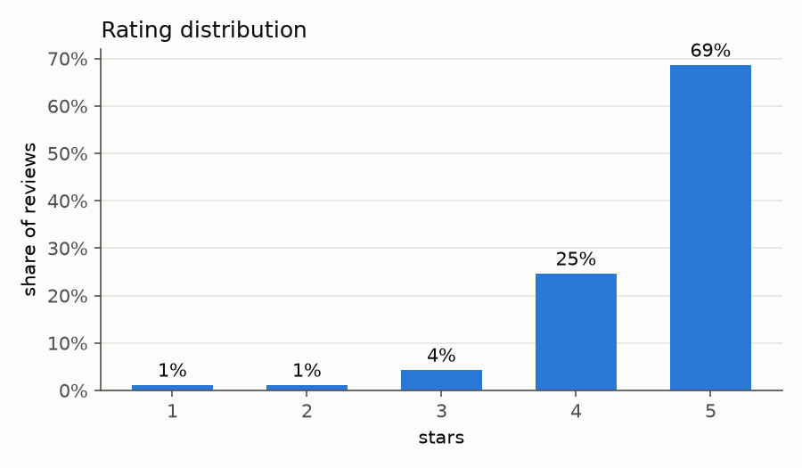
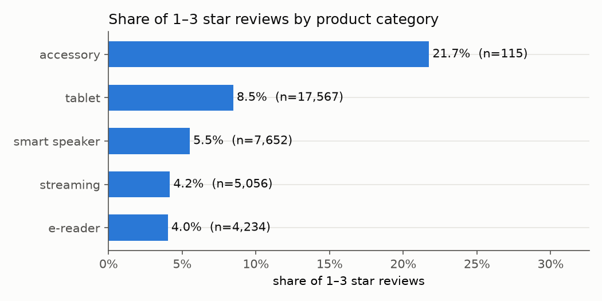
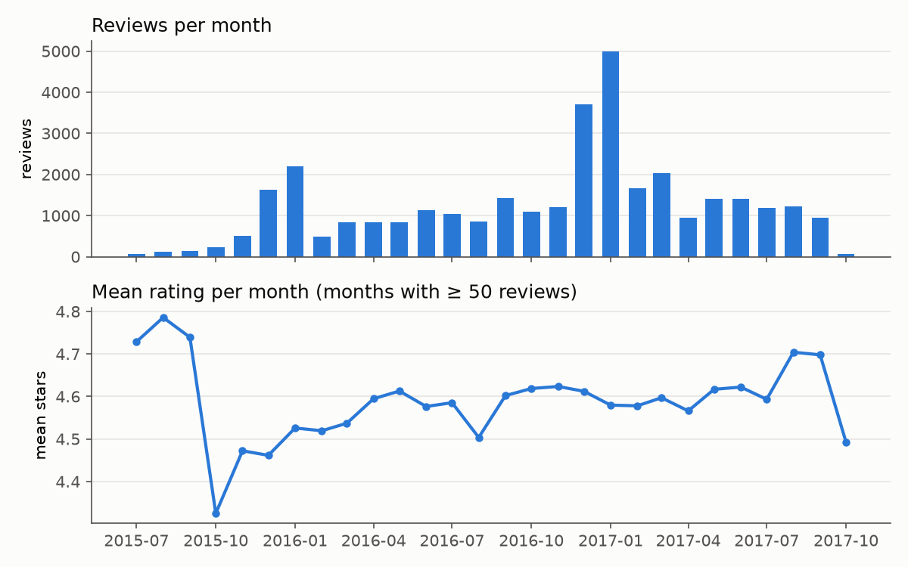
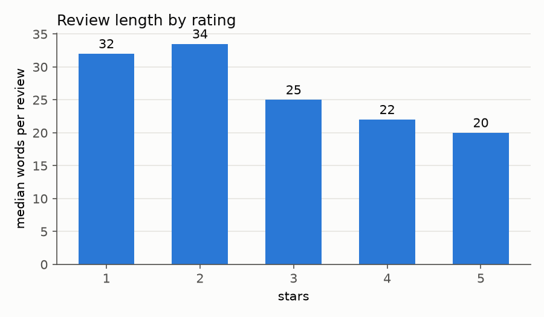

# Product review analytics

Analysis of consumer product reviews. It covers exploratory analysis and the factors behind
star ratings, a rating classifier built on review text and structured features, topic
extraction, theme tagging, and an LLM prototype that writes product descriptions from
positive reviews.

## Task

The input is a table of consumer reviews of electronics products. Each review has its text and title,
a 1–5 star rating, a "would recommend" flag, helpful votes, the product and the date.

1. **Exploratory analysis:** find 3–4 key insights about ratings and review patterns, make at
   least two informative charts, and name the top 5 factors that influence the rating.
2. **Rating prediction:** predict the rating from the review text plus at least one structured
   feature. Justify the features, preprocessing, algorithm and metric, report the performance
   and suggest one improvement. Also extract the 5 most common topics with keyword extraction.
3. **Generative AI prototype:** for a given product, identify 3 key features or benefits from
   its positive reviews, then generate a 2–3 sentence product description that highlights them.
   Use only free-tier LLM services.
4. **Bonus:** tag reviews with themes such as battery, design or performance.

The data is the public Kaggle dataset
[Consumer Reviews of Amazon Products](https://www.kaggle.com/datasets/datafiniti/consumer-reviews-of-amazon-products)
(file `1429_1.csv`, 34,660 reviews). It is not included in this repository. Download it from
Kaggle and pass its path with `--input`.

## Solution

1. **Loading and cleaning** ([src/data.py](src/data.py)):
   - keep only review fields; reviewer names and source URLs are dropped;
   - drop rows without a rating or text, leaving 34,624 reviews;
   - fill in missing product names from other rows of the same product;
   - assign a coarse category (tablet, e-reader, smart speaker, streaming, accessory) from
     product-name keywords;
   - add simple review statistics: word count, exclamation marks, share of capital letters,
     and log of helpful votes.
2. **Exploratory analysis** ([src/eda.py](src/eda.py)):
   - writes four charts and the headline numbers to `figures/`;
   - finds the factors behind the rating as the permutation importance (drop in R² on a
     held-out 25 %) of a gradient boosting model. Its inputs are the review statistics, the
     year, the category and the theme flags from step 5;
   - "would recommend" is left out of the factors: it is the reviewer's own verdict, a
     restatement of the rating rather than a cause, and alone it takes almost all the importance.
3. **Rating model** ([src/rating_model.py](src/rating_model.py)):
   - **Features:** word TF-IDF (1–2 grams, sublinear term frequency) of title and text, plus
     standardised review statistics, a one-hot product category and the recommend flag.
     Missing values are imputed with a missing indicator.
   - **Algorithm:** logistic regression. It is fast on 30k sparse documents, strong for
     TF-IDF text, and its coefficients are easy to inspect. `class_weight="balanced"` stops
     it from predicting 5 stars for everything. The regularisation strength C is tuned over
     0.5, 2 and 8 by an inner 3-fold CV inside each training fold (nested CV), so the test
     folds are never used to choose it.
   - **Metric:** macro-F1. With 69 % five-star reviews, accuracy rewards ignoring the rare
     1–3 star reviews, which are the ones that matter most. Accuracy, mean absolute error
     in stars and F1 for 1-star reviews are reported too.
   - **Evaluation:** stratified 5-fold cross-validation, reported as the mean ± 2 standard
     deviations across folds. The model is compared with a majority-class baseline and with
     feature subsets on the same folds. All preprocessing is fitted inside the training fold
     (one pipeline). The dataset has no duplicate review texts, so a plain split does not leak.
   - Character n-grams were tried as well. They added 0.005 macro-F1 at about 8× the training
     time, so they were dropped.
4. **Topics** ([src/topics.py](src/topics.py)) are extracted in two ways:
   - **Key phrases:** the bigrams and trigrams found in the most reviews. Stop words may appear
     inside a phrase, as in "easy to set", but not at its start or end.
   - **Topics:** NMF with 5 components on word TF-IDF. Each topic is described by its top
     keywords, and its size is the share of reviews where it is the dominant topic.
5. **Theme tagging** ([src/themes.py](src/themes.py)): a keyword lexicon for 14 themes
   (battery, display, performance, design, price, ease of use, sound, ...), matched as whole
   words. A review can carry several themes. For each theme the summary reports its share of
   reviews, the mean rating with and without it, and the share of low ratings.
6. **Product descriptions** ([src/describe.py](src/describe.py)):
   - takes up to 60 positive reviews (4–5 stars, not "not recommended"), most helpful and
     longest first, shortened to 400 characters each;
   - prompt 1 asks for 3 distinct, most praised features as JSON, each with a verbatim quote
     as evidence. The code checks that each quote occurs in the reviews, ignoring case and
     punctuation. If a quote is not found, the model is asked once more to replace that
     feature; quotes still not found are flagged;
   - prompt 2 writes 2–3 sentences from these features only. Any number in the description
     that is not in the product name or the quotes is flagged as a possibly invented
     specification;
   - uses the OpenAI-compatible API, so the same code runs on Gemini (default model alias
     `gemini-flash-latest`) or a local model in Ollama. The key comes from an environment
     variable;
   - `--dry-run` prints the prompt and the most mentioned themes without calling a model.

## Results

On the public dataset above.

**Insights** ([figures/insights.txt](figures/insights.txt)):
- **Ratings are very positive:** 69 % five stars, mean 4.58, only 2.3 % one or two stars.
- **Unhappy reviewers write more:** the median review is 32 words for 1–2 stars and 20 words
  for 5 stars.
- **Satisfaction differs by product type:** the share of 1–3 star reviews is 4.0 % for
  e-readers, 4.2 % for streaming devices, 5.5 % for smart speakers, 8.5 % for tablets and
  21.7 % for accessories (115 reviews).
- **Recommendation goes with the rating:** reviews that recommend the product average 4.68
  stars, and those that don't average 2.48. Only 4.1 % don't recommend.
- **Volume is seasonal:** reviews peak in December and January.

| | |
|---|---|
|  |  |
|  |  |

**Top 5 factors behind the rating**, ranked by permutation importance:

| Factor | Effect on rating |
|---|---|
| Product category | e-readers 4.73 on average, accessories 4.13 |
| Review length | longer reviews: −0.13 stars |
| Exclamation marks | reviews with any: +0.23 stars |
| Mentions of support or returns | −0.72 stars |
| Helpful votes | reviews with any: −0.23 stars |

Mentions of performance (−0.22) and battery (−0.26) come next. Together these factors explain
only 9 % of the variance in ratings (R² on held-out reviews), so the rating depends mostly on
what the text says.

**Rating model**, stratified 5-fold CV with C tuned in nested CV, mean ± 2 std across folds:

| Model | Macro-F1 | Accuracy | MAE (stars) | F1, 1 star |
|---|---|---|---|---|
| Majority class (always 5) | 0.163 | 0.687 | 0.415 | 0.000 |
| Text only | 0.464 ± 0.018 | 0.684 ± 0.009 | 0.355 ± 0.010 | 0.476 ± 0.082 |
| Text + review statistics + category | 0.462 ± 0.015 | 0.683 ± 0.008 | 0.360 ± 0.010 | 0.469 ± 0.072 |
| **Text + review statistics + category + recommend** | **0.497 ± 0.013** | **0.694 ± 0.007** | **0.337 ± 0.010** | **0.513 ± 0.038** |

- The inner CV chose C = 2 in every fold and for every model, so 2 is the default.
- 97.7 % of out-of-fold predictions are within one star.
- Most errors are between neighbouring ratings, 4 vs 5 and 2 vs 3
  ([confusion matrix](figures/confusion_matrix.png)).
- The text carries almost all of the signal. Review statistics and category add nothing
  beyond it, and the recommend flag adds 0.03 macro-F1, more than the spread across folds.

**Suggested improvement:** fine-tune a pretrained transformer such as DistilBERT on the text,
with an ordinal loss. Negation and context ("not bad", "returned it") are what a bag of words
misses. An ordinal loss also reflects that predicting 4 for a 5-star review is a smaller error
than predicting 1.

**Topics (NMF):**

| Share of reviews | Keywords | Mean rating |
|---|---|---|
| 35 % | echo, tv, alexa, music, device, fun, awesome, home, best, streaming | 4.58 |
| 20 % | tablet, price, kids, games, little, apps, excellent, value, tablets, money | 4.45 |
| 19 % | kindle, reading, read, books, reader, light, paperwhite, screen, new, perfect | 4.60 |
| 14 % | loves, gift, old, year, christmas, daughter, son, wife, perfect, grandson | 4.66 |
| 12 % | easy, set, setup, navigate, kids, read, simple, size, operate, install | 4.71 |

In plain words, the topics are: smart home and entertainment devices, affordable tablets for
kids and games, reading on e-readers, gifts, and ease of setup. The most common key phrases are
"year old", "battery life", "easy to set", "highly recommend", "play games" and "tablet for kids".

**Themes:** 84 % of reviews get at least one theme. Themes linked to lower ratings:

| Theme | Share of reviews | Mean rating with / without | Share of 1–3 stars with theme |
|---|---|---|---|
| Support & returns | 3 % | 3.88 / 4.60 | 31 % |
| Performance | 7 % | 4.38 / 4.60 | 14 % |
| Battery | 6 % | 4.34 / 4.60 | 13 % |
| Connectivity | 6 % | 4.37 / 4.60 | 12 % |

Ease of use, design, gift and voice assistant go with higher ratings (4.66–4.67).

**Product descriptions**, run with `llama3.2` (3B) in Ollama 0.40 on a CPU:

> **Kindle Paperwhite.** Key features, each with a verbatim quote that was found in the reviews:
> - Adjustable screen lighting: "the adjustable screen lighting is spot on and easy on my eyes,
>   whether I am reading"
> - Portability and weight: "it's very light weight and thus easier to hold then a traditional book"
> - Backlit display: "the backlit screen makes reading at night very easy. I am a heavy reader
>   and the battery still lasts for weeks!"
>
> *The Amazon Kindle Paperwhite features an adjustable screen lighting that is spot on and easy
> on the eyes, whether reading. Its lightweight design makes it very easy to hold, providing a
> more portable reading experience. The backlit display and glare-free reading capabilities make
> it ideal for reading at night, allowing for weeks of battery life.*

What the checks caught, on three products (an e-reader, a smart speaker and a kids tablet):
- **An invented specification.** Before the stricter prompt, a description said the reader
  weighs "6.3 ounces", which no review says. The number check now flags such cases.
- **Invented or merged quotes.** For the smart speaker, the small model first produced 2 of
  3 quotes that are not in any review. One was "millions of trivia games", stitched together
  from "millions of songs" and "trivia games" in different reviews. After the retry, 2 of 3
  quotes were verbatim and the third (a paraphrase) was still flagged.
- **Loose wording.** The descriptions are fluent but sometimes stretch a feature ("integrates
  with smart home automation" from a quote about timers and radio). A larger model, such as
  Gemini, should follow the evidence more closely, but that was not tested here.

**Limitations:**
- Almost all reviews are for one brand's own devices, and about half come from two products,
  so the findings describe this catalogue rather than reviews in general.
- The factors are associations, not causes.
- The theme lexicon is hand-made, so it misses synonyms and does not handle negation
  ("no battery issues" counts as battery).
- The quote and number checks catch invented evidence and specifications, not claims that
  merely stretch a real quote. A human should review descriptions before publishing them.

## Project structure

```
product-review-analytics/
├── README.md
├── requirements.txt
├── figures/              # charts and tables written by eda.py and rating_model.py
├── tests/                # pytest on synthetic reviews, no dataset needed
└── src/
    ├── data.py           # load, clean, generic column names, review statistics
    ├── eda.py            # insights, charts, factors behind the rating
    ├── rating_model.py   # TF-IDF + logistic regression, cross-validated comparison
    ├── topics.py         # key phrases and NMF topics
    ├── themes.py         # keyword-lexicon theme tagging
    └── describe.py       # LLM product description from positive reviews
```

## Usage

```sh
python -m venv .venv && source .venv/bin/activate
pip install -r requirements.txt
pytest tests                                                    # a few seconds

DATA=path/to/1429_1.csv
python src/eda.py --input $DATA --output figures
python src/rating_model.py --input $DATA --output figures      # slowest step (nested CV); --c-grid 2 skips tuning, ~7× faster
python src/topics.py --input $DATA
python src/themes.py --input $DATA --output reviews_with_themes.csv

python src/describe.py --input $DATA --product "Paperwhite" --dry-run
export GEMINI_API_KEY=...                                       # key from Google AI Studio
python src/describe.py --input $DATA --product "Paperwhite"
```

The Gemini model can be changed with `--model` or `LLM_MODEL`. A key from a project with
billing set up but no credit is rejected; create the key in a project without billing to use
the free tier.

With a local model in Ollama, no key is needed. See the step-by-step guide below.

## Running a local LLM with Ollama: step by step

[Ollama](https://ollama.com) runs language models on your own computer. It is free, needs no
account or key, and your data never leaves the machine. The examples below were run on a CPU,
without a GPU.

**1. Install Ollama** (once). Download it from https://ollama.com/download. On an older
Intel Mac where that or `brew install ollama` fails, take the prebuilt command-line build
from GitHub (this is what was tested here):

```sh
mkdir -p ~/.local/ollama && cd ~/.local/ollama
curl -L -o ollama-darwin.tgz https://github.com/ollama/ollama/releases/latest/download/ollama-darwin.tgz
tar -xzf ollama-darwin.tgz && rm ollama-darwin.tgz
echo 'export PATH="$HOME/.local/ollama:$PATH"' >> ~/.zshrc && source ~/.zshrc
ollama --version
```

**2. Start the server** (each time you want to use it; it keeps running in the background):

```sh
OLLAMA_CONTEXT_LENGTH=8192 ollama serve > /dev/null 2>&1 &
```

`OLLAMA_CONTEXT_LENGTH=8192` lets the model read about 8,000 tokens (roughly 6,000 words) at
once. The prompt in `describe.py` is about 6,000 tokens. With the smaller automatic setting,
the prompt can be cut off without any error.

**3. Download a model** (once; `llama3.2` is a 3B model of about 2 GB):

```sh
ollama pull llama3.2
ollama list
```

```
NAME               ID              SIZE      MODIFIED
llama3.2:latest    a80c4f17acd5    2.0 GB    22 minutes ago
```

**4. Ask it something** from the terminal:

```sh
ollama run llama3.2 "In one sentence, what do these reviews praise? Review 1: The battery lasts for weeks. Review 2: The screen is easy on the eyes, even at night."
```

```
These reviews praise the device's battery life and display quality, highlighting the device's
ability to provide long-lasting power and a comfortable viewing experience.
```

Run `ollama run llama3.2` without a question to chat interactively, and type `/bye` to leave.

**5. Call it from code.** Ollama also serves an OpenAI-compatible API at
`http://localhost:11434/v1`, which is what `describe.py` uses:

```sh
curl -s localhost:11434/v1/chat/completions -H "Content-Type: application/json" -d '{
  "model": "llama3.2", "temperature": 0,
  "messages": [{"role": "user", "content": "Name the 2 product features praised here, as a JSON list: \"Battery lasts for weeks. The screen is easy on the eyes.\""}]}'
```

The answer's `choices[0].message.content` is:

````
Here is the list of praised product features as a JSON list:

```
[
  "Battery lasts for weeks",
  "Screen is easy on the eyes"
]
```
````

The model wraps JSON in extra text and a code block; `describe.py` extracts the JSON from it.

**6. Run this project's description step** on the local model. The prompt holds 60 reviews, so
without a GPU this takes much longer than the short question above. The output is shown under
Results.

```sh
python src/describe.py --input $DATA --product "Paperwhite" --base-url http://localhost:11434/v1 --model llama3.2
```

**7. Stop the server** when you are done, to free memory:

```sh
pkill -f "ollama serve"
```

**If something goes wrong:**

| Message | Cause and fix |
|---|---|
| `could not connect to ollama server` (terminal) or `Connection error` (`describe.py`) | The server is not running: do step 2. |
| `pull model manifest: file does not exist` | The model name is misspelled: check it with `ollama list`. |
| `command not found: ollama` | It is not on your PATH: open a new terminal, or use the full path `~/.local/ollama/ollama`. |
| Answers ignore most of the reviews | The context window is too small: restart the server as in step 2. |

## Data licence

The dataset is published by Datafiniti on Kaggle under
[CC BY-NC-SA 4.0](https://creativecommons.org/licenses/by-nc-sa/4.0/). The charts and tables in
[figures/](figures/) are derived from it and are shared under the same licence.
