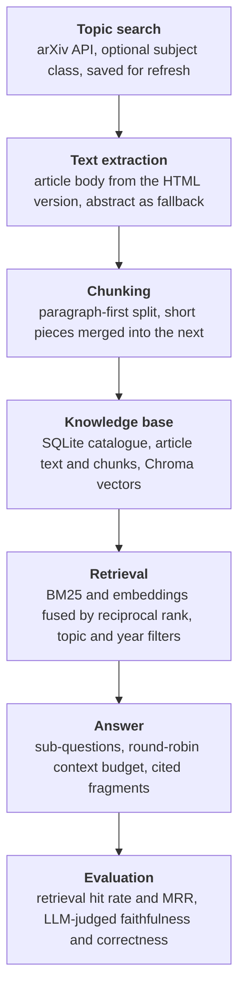

# Research paper knowledge base

A command-line system that searches scientific papers by topic, builds a local knowledge
base from them, and answers complex questions with citations. Everything runs locally:
sentence-transformer embeddings for search and a local Ollama model for the language steps,
so no paid API and no API key are needed.

## Task

Researchers need the relevant literature on a topic, not a list of links. Build a system that:

1. **Mines sources.** Search a public paper source for a topic, extract the article text and
   split it in a way that keeps each piece self-contained, then store it in a vector database
   that can be queried.
2. **Answers complex questions.** A question such as "how well does X work for Y, and what
   are the limits?" cannot be answered by a single search. Break it into sub-questions, search
   for each, and compose one grounded answer from what was retrieved.
3. **Is production-shaped.** Configuration instead of constants, structured logging, error
   handling that degrades instead of crashing, incremental and idempotent updates, tests.
4. **Can be evaluated.** Show how to measure whether the answers are any good — both whether
   the right documents are found and whether the generated answer is faithful and correct.

No paper text or vector database is included in this repository: the knowledge base is built
from public [arXiv](https://arxiv.org) papers with the commands below, and papers stay on
arXiv. The repository ships the code, the prompts, and a labelled question set
([eval/questions.json](eval/questions.json)) that names papers by their arXiv id.

## Architecture



## Solution

1. **Topic search** ([src/paper_kb/sources/arxiv.py](src/paper_kb/sources/arxiv.py)) queries the
   arXiv API. A quoted topic is searched as a phrase, and `--category` narrows the search to a
   subject class such as `q-fin.TR` or `cs.IR`. Requests go through a polite client
   ([sources/http.py](src/paper_kb/sources/http.py)) that keeps arXiv's 3-second interval and
   retries on 429, 5xx and network errors with a growing delay.
2. **Text extraction** ([src/paper_kb/extract.py](src/paper_kb/extract.py)) reads the article
   body out of the HTML (LaTeXML) version of a paper: navigation, author block, footnotes,
   acknowledgements and the reference list are dropped, formulas are replaced by their LaTeX
   source, and figure captions are kept. A paper with no HTML version falls back to its
   abstract, and the record says which of the two it holds (`text_kind`).
3. **Chunking** ([src/paper_kb/ingest.py](src/paper_kb/ingest.py)) splits on paragraph breaks
   first, then lines, sentences and words (1000 characters, 100 overlap). Section headings stay
   attached to the paragraph below them and pieces shorter than 200 characters are merged
   forward, so no chunk is a bare heading or a sentence tail.
4. **Knowledge base** ([src/paper_kb/store.py](src/paper_kb/store.py)) keeps the catalogue in
   SQLite (papers, saved topics, paper-topic links, chunk texts, notes) and the vectors in
   Chroma under the same chunk ids.
   - Ingestion is **incremental and idempotent**: a paper already stored at the same version is
     only linked to the topic, and a new arXiv version replaces its chunks in both stores in one
     transaction. Re-running a topic downloads nothing.
   - SQLite is the source of truth: the extracted article text is stored once, so `rechunk`
     re-splits every paper and `reindex` re-embeds everything **without downloading anything
     again**. The embedding model is recorded, and a different one in the settings is refused
     with a message instead of silently mixing vector spaces.
   - A failing paper or a failing source is logged and skipped; the rest of the topic still lands.
5. **Retrieval** ([src/paper_kb/retrieval.py](src/paper_kb/retrieval.py)) offers three modes.
   `dense` searches embeddings, `bm25` searches keywords, and `hybrid` merges both rankings with
   reciprocal rank fusion. Keyword search is there because scientific queries carry exact terms
   (`BM25`, `GPT-4`, `q-fin.TR`) that embeddings blur; the tokenizer keeps hyphenated and
   alphanumeric terms. Results can be limited to a saved topic or to recent years.
6. **Answering** ([src/paper_kb/answer.py](src/paper_kb/answer.py)) is decomposition RAG: the
   model splits the question into sub-questions, each is searched, and the fragments are taken
   **round-robin** so every sub-question is represented before the character budget runs out.
   The answer must cite fragment numbers, which are checked against the fragments actually sent.
   If decomposition fails the original question is used; if generation fails the retrieved
   sources are still returned. Every answer carries a request id through the logs.
7. **Reading notes** ([src/paper_kb/notes.py](src/paper_kb/notes.py)) ask the local model for a
   structured note per paper (problem, method, data, findings, limitations, keywords). Notes are
   stored and indexed as searchable chunks, so a search can hit a summary as well as raw text.
8. **Topic digest** ([src/paper_kb/digest.py](src/paper_kb/digest.py)) exports a topic as one
   markdown file: a table of papers, then a section per paper with its note or abstract.
9. **Evaluation** ([src/paper_kb/evaluate.py](src/paper_kb/evaluate.py)) measures the two halves
   separately, which is what makes a bad answer diagnosable:
   - **Retrieval**, with no LLM: for each labelled question, the rank of the first chunk from a
     paper marked relevant gives hit rate and MRR, for all three search modes.
   - **Parameter sweep** (`kb sweep`, no LLM): every combination of mode, `k` and fusion
     constant is scored on the same questions, best first, so the defaults are picked from
     measurements rather than taste.
   - **Answers**, with an LLM judge: the judge lists the answer's claims and marks each as
     supported by the retrieved fragments (**faithfulness**, the hallucination check), then lists
     the key facts of the reference answer and marks each as stated in the answer
     (**correctness**). Both scores are computed **in code** from the per-item verdicts rather
     than asking the model for a number, and a judge failure is recorded as missing instead of
     being scored zero. Citation validity is checked without the LLM.
   Each question is scored in both wordings and results are broken down per topic, so a weak
   topic cannot hide inside the mean. All prompts live in [prompts/](prompts/) as plain text
   files, and the judge can be a second model if you do not want the model grading its own work.

## Project structure

```
research-paper-knowledge-base/
├── README.md
├── requirements.txt
├── pyproject.toml              # package metadata and the `kb` command only
├── config/
│   └── settings.json           # sources, chunking, retrieval, model, rate limits
├── prompts/                    # decompose, synthesize, note, judge_* (plain text)
├── eval/
│   └── questions.json          # 12 labelled questions, each with a paraphrase
├── src/paper_kb/
│   ├── cli.py                  # argparse command line, one function per command
│   ├── settings.py             # JSON config + KB_* environment overrides, validated
│   ├── paper.py                # the Paper record and its content hash
│   ├── sources/
│   │   ├── arxiv.py            # topic search, feed parsing, full-text fetch
│   │   └── http.py             # rate-limited client with retries
│   ├── extract.py              # article body out of arXiv HTML
│   ├── ingest.py               # chunking, incremental topic ingestion, refresh
│   ├── store.py                # SQLite catalogue + Chroma vectors, rechunk/reindex
│   ├── retrieval.py            # dense, BM25 and hybrid search with filters
│   ├── answer.py               # decomposition RAG with citation checking
│   ├── notes.py                # structured per-paper reading notes
│   ├── digest.py               # markdown export of a topic
│   ├── evaluate.py             # retrieval metrics, LLM judges, parameter sweep
│   └── llm.py                  # Ollama client, JSON-schema replies
└── tests/
    ├── conftest.py             # hashing embedding, scripted LLM, fake source
    ├── fixtures/               # hand-written arXiv feed and HTML paper
    └── test_*.py               # 36 offline tests
```

## Usage

Install it as a package to get the `kb` command (dependencies stay in `requirements.txt`):

```sh
python -m venv .venv && source .venv/bin/activate
pip install -r requirements.txt
pip install -e .            # provides `kb`; or skip and use `python -m paper_kb` from src/
```

The language steps (`ask`, `notes`, `eval --answers`) need a local Ollama server and model:
see [Local model (Ollama)](#local-model-ollama). Everything else runs without it.

Build a knowledge base, then query it:

```sh
# search a topic and index the papers; --category narrows the arXiv subject class
kb ingest '"limit order book"' --category q-fin.TR --max-results 8
kb ingest '"retrieval augmented generation"' --category cs.IR --max-results 8
kb ingest '"volatility forecasting"' --category q-fin.ST --max-results 6

kb topics                       # saved topics, with paper counts
kb papers --topic '"limit order book"'
kb show arxiv:2403.09267        # one paper with its note
kb stats

# search fragments, no LLM
kb search "order book imbalance and price moves" -k 5 --mode hybrid

# complex question, decomposed and answered with citations
kb ask "How well do deep models forecast order book moves, and is that tradable?"

# knowledge-base extras
kb notes --topic '"limit order book"'
kb digest '"limit order book"' --output digests/order-book.md
kb refresh                      # re-run every saved search (cron-friendly)

# maintenance, both offline: no downloads, rebuilt from the stored article text
kb rechunk                      # after changing chunk size or overlap
kb reindex                      # after changing the embedding model

# evaluation and tuning
kb eval --questions eval/questions.json --output results
kb eval --questions eval/questions.json --output results --answers   # slow, uses the LLM
kb sweep --questions eval/questions.json --k-values 3 5 10 --rrf-values 10 60 200
```

Settings live in [config/settings.json](config/settings.json) and any of them can be overridden
by an environment variable (`KB_RETRIEVAL_K=8`, `KB_OLLAMA_MODEL=...`) or by `--data-dir`.

Tests run offline — no network, no model download, no Ollama — using small hand-written
fixtures, a hashing embedding and a scripted LLM:

```sh
python -m pytest tests
```

## Results

Measured on a knowledge base built from seven topics (quantitative finance, econometrics,
economics, machine learning, information retrieval, statistics, mathematics): 50 papers,
47 of them with full text, 5805 chunks. Scored on the 12 labelled questions in
[eval/questions.json](eval/questions.json), each asked twice — once in the papers' own
vocabulary and once paraphrased into a user's words — at k = 5.

| Search mode | Hit rate, paper wording | MRR | Hit rate, paraphrased | MRR |
|---|---|---|---|---|
| `bm25` | **1.00** | **0.89** | 0.42 | 0.27 |
| `dense` | 0.83 | 0.77 | **0.75** | **0.37** |
| `hybrid` | 0.92 | 0.82 | 0.50 | 0.35 |

The two wordings disagree completely, which is the point of measuring both. Keyword search is
perfect when the question reuses the paper's terms and collapses to 0.42 when it does not;
embeddings barely move between the two (0.83 → 0.75) and win on paraphrases. A question set in
the papers' vocabulary alone would have "proved" that BM25 is best and that the embeddings were
not worth having. `hybrid` is the default because it is the only mode that is never the worst:
it keeps most of BM25's exact-term advantage and most of the embeddings' robustness.

Parameter sweep over both wordings (`kb sweep`, no LLM), best of 27 combinations:

| Setting | Searched | Best |
|---|---|---|
| mode | `dense`, `bm25`, `hybrid` | `hybrid` |
| `k` | 3, 5, 10 | 10 (MRR 0.606 vs 0.585 at 5, 0.576 at 3) |
| fusion constant | 10, 60, 200 | 60, but it hardly matters (0.595 – 0.606) |

`retrieval_k` is set to 10 in the defaults because of this. The fusion constant is left at 60
and the sweep is in the repository so the claim can be rechecked rather than believed.

### What these numbers are not

- **The question set is small and self-made**: 12 questions, written after reading the papers,
  labelled by me. It is enough to compare search modes against each other, not to state an
  absolute quality level.
- **The judge is the model being judged.** By default one model answers *and* grades, so
  faithfulness and correctness are self-assessed and biased upward. Pointing the judge at a
  second model is the honest configuration — see [Local model (Ollama)](#local-model-ollama).
- **Answer scores are not reported here.** Retrieval is deterministic and cheap to re-measure,
  while answer scores on a 3B model on a CPU are slow and shift between runs; the harness and
  its prompts are in the repository so they can be run on a better model.

## Local model (Ollama)

Only the language steps need a model: `ask`, `notes` and `eval --answers`. Ingestion,
`search`, `rechunk`, `reindex` and `sweep` never call it, so the knowledge base can be built
and searched without any of this.

1. **Install Ollama** from [ollama.com/download](https://ollama.com/download), or with a package
   manager. If your package manager has no prebuilt package for your platform it may try to
   build from source — download the official binary instead, which needs no build and no admin
   rights.
2. **Start the server** and leave it running in its own terminal:

   ```sh
   ollama serve
   ```

3. **Pull the model** (about 2 GB for the default):

   ```sh
   ollama pull llama3.2
   ```

4. **Check both** before running anything slow:

   ```sh
   curl -s localhost:11434/api/tags | head -c 200     # server up, models listed
   kb ask "test"                                      # exits with a clear message if not
   ```

   `kb` checks the server and the model before it starts work and exits with status 2 and an
   explicit message rather than failing part way through a long job:

   ```
   ERROR paper_kb: Ollama is not reachable at http://localhost:11434: start it with `ollama serve`
   ERROR paper_kb: Ollama model 'does-not-exist' not found: run `ollama pull does-not-exist`
   ```

**Context length.** The client asks for the context window per request
(`ollama_num_ctx`, 8192 by default), so `OLLAMA_CONTEXT_LENGTH` does not need to be set. If your
Ollama build ignores the per-request value, start the server with `OLLAMA_CONTEXT_LENGTH=8192`:
too small a window truncates the prompt **silently**, and the symptom is an answer that ignores
most of its fragments. The client logs a warning when a prompt fills the whole window, and
`notes` cuts paper text to `notes_max_chars` to stay inside it.

**Choosing the model.** Any Ollama model works — no code change, just configuration:

```sh
KB_OLLAMA_MODEL=qwen2.5:14b kb ask "..."     # bigger model, better answers, slower
KB_OLLAMA_URL=http://gpu-box:11434 kb ask "..."   # Ollama on another machine
```

The defaults are deliberately small so the system runs on a laptop CPU with no GPU. A larger
model mainly improves the quality of sub-questions, notes and judging; retrieval is unaffected
because it uses sentence-transformer embeddings, not Ollama. For evaluation you can point the
judge at a second model or a second Ollama instance (`ollama_judge_model`, `ollama_judge_url`)
so the model does not grade its own answers.

**Behaviour of the default model.** `llama3.2` (3B) on a CPU is the quality and speed ceiling
here, not a property of the design:

- Decomposition and synthesis are the slow steps, and they dominate `eval --answers`; everything
  else needs no LLM at all.
- The note prompt has to insist on full sentences, or a small model answers fields with bare
  acronyms. This is why [prompts/note.txt](prompts/note.txt) spells out what each field must
  contain.
- The model cites only some of the fragments it is given, so the cited list in `kb ask` is
  normally shorter than the source list; both are printed, and `--json` shows which numbers the
  answer actually used.
